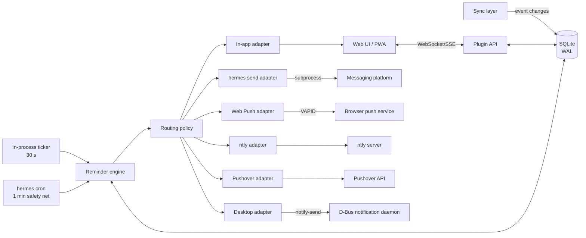
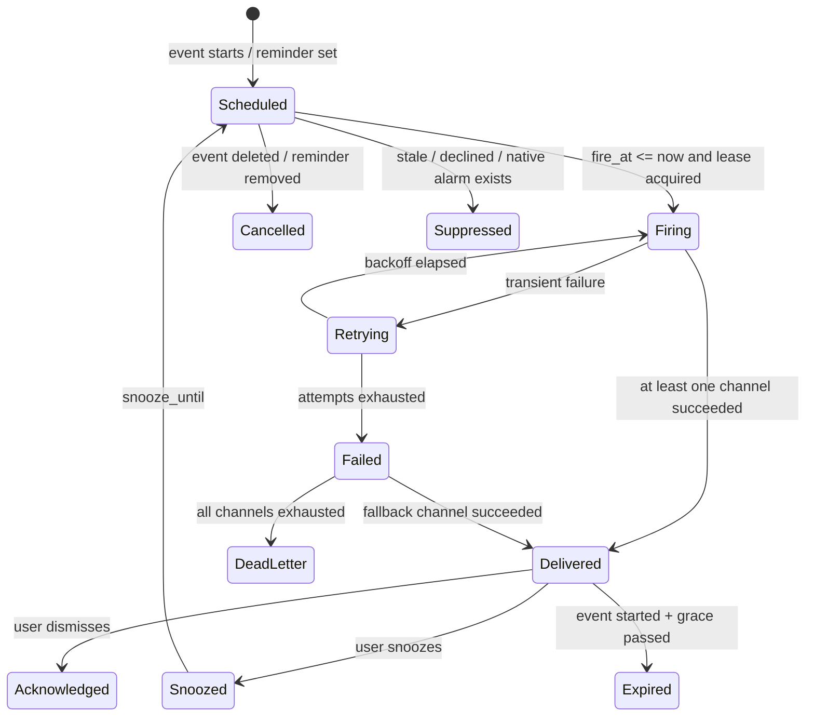
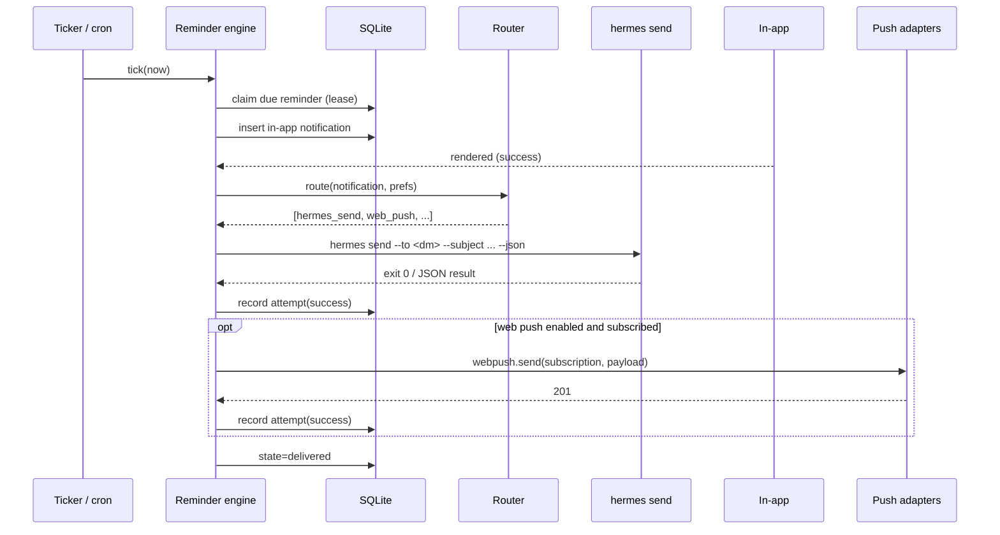

# App notifications and reminders

| | |
|---|---|
| Status | Draft |
| Date | 2026-11-12 |
| Branch | `feature/app-design` (off `test`) |
| Scope | How a calendar reminder reaches the user |
| Companion docs | `core-design`, `sync-design`, `research-hermes-api` (sibling branches, in flight) |

## TL;DR

**Recommendation: make Hermes gateway messaging via `hermes send` the default
out-of-app delivery channel, keep the local web UI as the always-on in-app
surface, and support Web Push, ntfy, Pushover, and desktop notifications as
pluggable, opt-in adapters.**

Concretely:

1. **MVP** — an in-app notification centre (local web UI) plus out-of-app
   delivery through `hermes send` to the user's already-configured messaging
   platform (Matrix/Telegram/Signal/Discord/…). This needs no new accounts,
   works while the UI and app are closed, and reaches the phone the user
   already carries.
2. **Phase 2** — Web Push for installed PWAs, snooze/acknowledge in the app,
   quiet hours, digests, and presence-based suppression of duplicates.
3. **Phase 3** — optional ntfy and Pushover adapters (native push without a
   chat bot; Pushover only when acknowledgement/emergency escalation is
   required), and an optional Linux desktop `notify-send` adapter.

The rest of this document explains the options, the scoring, the recommended
architecture, and the failure modes that the implementation must handle.

---

## 1. Problem

A calendar is only useful if the user is told when something is about to
happen. The plugin stores events locally and syncs them (see `sync-design`),
but nothing yet decides **when** a reminder fires, **where** it is delivered,
or **what happens when delivery fails**.

The hard parts are not the notification API calls. They are:

- **The app is usually not open.** A timer in a browser tab, or a process that
  only runs while the UI is open, cannot be the scheduler.
- **The user is not always at the machine running Hermes.** A desktop-only
  notification is invisible when the user is away from their desk.
- **Calendar data is sensitive.** Reminder text leaks event titles, locations,
  and attendees to whichever third party carries the notification.
- **Duplicates and spam destroy trust faster than a missed reminder.** One
  event can have several reminders, several devices, and several delivery
  paths. Exactly-once user-visible delivery is the goal; at-least-once
  transport is the reality.
- **Reminders are time-critical.** Retry policies, quiet hours, DST, travel,
  and "the laptop was asleep" all have to be designed, not discovered.

### Goals

1. Deliver a reminder within ±60 s of its scheduled time under normal
   conditions, on at least one channel the user actually looks at.
2. Work with the web UI closed, the browser closed, and the desktop session
   locked.
3. Never require a second account or a second set of credentials when the user
   already has Hermes configured.
4. Keep notification content minimal by default and let the user choose a
   richer or more private channel.
5. Make delivery observable: every attempt is logged, every failure is
   surfaced, and the user can test a channel end to end.
6. Avoid duplicate notifications across channels and retries.

### Non-goals

- Building a mobile native app. Web Push and messaging platforms cover mobile.
- Replacing the platform's own calendar notifications for events the user
  created in Google/Apple/Outlook. We notify for events **this** calendar
  manages, and we must not double-notify events that already have a native
  alarm (see §9.7).
- Inbound conversational control of reminders in v1 (snooze by replying to the
  bot). Designed for in §7.6, shipped later.
- Rich notification UI (map, attendee actions) inside the notification itself.

## 2. Assumptions

These are stated so the rest of the doc is falsifiable. If `core-design`
chooses differently, the adapter boundaries below still hold.

- **A1.** The product is a Hermes plugin: Python, packaged with `plugin.yaml`,
  using a plugin data directory for durable state.
- **A2.** It exposes a **local web UI** (served by the plugin or by Hermes'
  web server) that can be installed as a PWA. It is reachable on
  `127.0.0.1` and optionally on a LAN/Tailscale address.
- **A3.** A long-running **plugin service** (the thing serving the UI) can run
  the scheduler, but the scheduler must also make progress when that service
  is not running.
- **A4.** Hermes is installed on the same machine, with at least one messaging
  platform configured. `hermes send --list` returns at least one usable target
  for the typical user.
- **A5.** The host is a Linux desktop (the current dev environment is
  Cinnamon/X11), but the design must not assume a desktop session exists.
- **A6.** Reminders are single-user in v1. Multi-user/shared calendars are a
  later concern.
- **A7.** The sync layer emits change events (created/updated/deleted) for
  events, including cancellations, and exposes each event's timezone and
  recurrence rule.

## 3. Requirements

| ID | Requirement | Notes |
|---|---|---|
| R1 | Fire N minutes/hours/days before an occurrence, configurable per event and as a default | Offsets, not absolute times, survive event edits |
| R2 | Multiple reminders per event, each with its own channel policy | e.g. 1 day before → in-app, 15 min before → phone |
| R3 | Recurring events expand correctly, including exceptions and cancellations | Materialize a bounded horizon |
| R4 | Correct across DST, timezone changes, and travel | Store UTC instants; render in the event/user timezone |
| R5 | Delivered when the UI is closed and the machine was asleep at fire time | Cron safety net + catch-up + staleness suppression |
| R6 | Quiet hours; critical reminders may override | Per-user, with calendar-level override |
| R7 | Snooze (5/10/60 min) and dismiss | In-app v1; inbound command later |
| R8 | No duplicate user-visible notifications from retries or multiple tickers | Idempotency keys + leases |
| R9 | Delivery attempts and failures are visible and testable | `reminders doctor`, per-channel test button |
| R10 | Content is minimal by default; full details are opt-in | Redaction and link policy |
| R11 | No calendar-derived text is executed as a command or template | Injection defense |
| R12 | Works without ntfy/Pushover accounts; those are optional | Graceful degradation |

### Non-functional targets

- **Latency:** p95 ≤ 60 s from `fire_at` to adapter hand-off; ≤ 5 s for
  in-app when a tab is open.
- **Durability:** a reminder that has fired is never lost before an attempt is
  recorded; attempts survive process restart.
- **Overhead:** ≤ 25 MB RSS and negligible CPU when idle, outside the host app.
- **Availability:** no single optional provider (ntfy, Pushover) can block
  delivery on another channel.
- **Privacy:** no event content in logs by default; secrets never in the
  calendar database or in the repo.

## 4. Option space

Four delivery families are on the table. They differ less in "can it show a
banner" than in **where the user is**, **what happens when the app is closed**,
and **who sees the data**.

### Option A — Local web UI / PWA

**What it is.** The app's own UI shows an in-app notification centre, a live
"up next" strip, and OS-level notifications via the browser `Notification`
API where permitted. Installed as a PWA with a service worker, it can also
receive **Web Push** (Push API + VAPID) while the app is closed.

**How reminders fire.** The server (not the page) owns the schedule. On fire,
it writes an in-app notification row and pushes it to open tabs over
WebSocket/SSE. If the user opted into Web Push, the server also sends an
encrypted push message to each stored subscription; the service worker renders
the notification.

**Strengths**

- No third-party account, no per-message cost, no message-length tax.
- Best interaction surface: snooze, dismiss, open event, edit reminder.
- Rich, branded UI; can show a full agenda rather than one line.
- Content stays between the user's server and the browser push service
  (payload is encrypted end-to-end to the browser; the push service sees
  metadata only).
- Zero setup for the "app is open on my second monitor" case.

**Weaknesses and constraints**

- **Web Push is not a scheduler.** A closed tab cannot run timers; service
  workers do not get reliable periodic execution (Periodic Background Sync is
  unavailable on iOS and heavily restricted in Chromium). The server must
  push.
- **iOS/iPadOS:** Web Push works only for PWAs **added to the Home Screen**
  (16.4+), and permission must be requested from a user gesture. This is a
  real install-funnel cost, not a footnote.
- **Desktop Safari** supports Web Push (16.4+); Chromium and Firefox do too.
  localhost is a secure context, so no TLS is needed for local dev, but a
  remote phone needs HTTPS.
- **Delivery is best-effort.** Browser push services throttle, coalesce, and
  drop; no delivery receipts; TTL/urgency are hints. A phone in low-power mode
  may hold notifications.
- **Subscriptions expire** (browser updates, permission resets, PWA
  uninstall). The server must prune 404/410 endpoints and show
  "notifications are off" in the UI.
- A phone that has never installed the PWA gets nothing from this channel.
- Localhost deep links (`http://127.0.0.1:PORT/...`) are useless on a phone;
  links require a configured reachable base URL.

**Effort:** medium (service worker, VAPID key management, subscription
lifecycle, permission UX). **Cost:** zero. **Privacy:** good.

### Option B — Desktop tray / local notifications

**What it is.** A small companion that shows reminders on the machine running
Hermes: a tray icon with "next event" and a menu, plus OS notifications via
`notify-send`/libnotify over D-Bus (`org.freedesktop.Notifications`). On
Linux this needs no tray at all for the notification itself; a tray icon is
optional chrome.

**How reminders fire.** The scheduler calls `notify-send` (or a long-lived
helper with a D-Bus connection) when the user's desktop session is active.
Urgency maps to `low`/`normal`/`critical`; critical notifications are not
auto-dismissed by compliant daemons.

**Strengths**

- Native, instantaneous, free, fully local: calendar text never leaves the
  machine.
- Great for "I'm at my desk and the app is minimized".
- `notify-send` is one subprocess call; no packaging required for the basic
  version.
- Can carry actions if the notification daemon supports them (varies by
  desktop).

**Weaknesses and constraints**

- **Desk-bound.** Useless when the user is away, which is exactly when many
  reminders matter.
- Requires an active graphical session and a notification daemon; fails under
  SSH, in a container, or when the session is starting up.
- Cross-platform trays (macOS menu bar, Windows notification area) mean
  platform-specific code or a heavyweight Electron/Tauri shell. A tray app is
  a second distribution artifact and a second updater.
- Notification actions and persistence differ by desktop; behavior is hard to
  test in CI.
- If Hermes runs on a headless box (as the current setup does over SSH),
  desktop notifications appear on the wrong machine unless the helper runs on
  the user's local machine.

**Effort:** low for `notify-send`, high for a real cross-platform tray app.
**Cost:** zero. **Privacy:** excellent.

### Option C — ntfy / Pushover push

Two hosted push services with different personalities. They are grouped
because both give **native push to a phone without a chat bot**, but they are
not interchangeable.

#### C1. ntfy

**What it is.** An HTTP pub/sub notification service. Publish by POSTing to a
topic (`https://ntfy.sh/<topic>` or a self-hosted server); the ntfy app on
Android/iOS, the web app, or a CLI subscribes. No account required.

**Relevant capabilities**

- Priorities 1–5 (`min`…`max`/`urgent`), tags/emoji, title, click-through URL.
- Action buttons: `view`, `http`, `broadcast` (Android), `copy`; up to three.
- Attachments (ntfy.sh: 15 MB, expire after 3 hours); message cache on the
  server (12 h default).
- Self-hostable, UnifiedPush support, access tokens/ACLs on a self-hosted
  instance.
- Message body limit is 4,096 bytes by default on ntfy.sh; header values have
  encoding caveats for non-ASCII.

**Strengths**

- Simple, cheap, scriptable; one HTTP POST per reminder.
- Works on a phone with no chat account and no bot identity.
- Self-hosting keeps all content on infrastructure the user controls.
- Action buttons can deep-link into the calendar or hit a local endpoint.

**Weaknesses and constraints**

- **The topic is the password.** On the public server, anyone who guesses or
  learns the topic can read messages. Use a long random topic or self-host.
- Public ntfy.sh is a third party; do not assume end-to-end encryption.
- No delivery receipts; the publisher learns "accepted by server", not
  "seen by human".
- Requires installing the ntfy app (another app, another permission grant).
- iOS background delivery depends on APNs and the app's settings; users who
  disable ntfy notifications get silence with no signal to us.

**Effort:** low. **Cost:** free (self-host costs a host; ntfy Pro optional).
**Privacy:** fair on public topics, good when self-hosted.

#### C2. Pushover

**What it is.** A paid, polished push service with a simple REST API
(`POST https://api.pushover.net/1/messages.json`, app token + user key),
native iOS/Android/desktop clients, and a strong story for
**acknowledgement-required** notifications.

**Relevant capabilities**

- Priorities −2…2; priority 2 is **emergency**: repeats every `retry` seconds
  (min 30) until acknowledged or `expire` (max 3 h), returns a `receipt`, and
  supports a callback URL for acknowledgement.
- Supplementary URL, sounds, TTL, HTML/monospace, one image attachment
  (≤5 MB), optional end-to-end encryption.
- 1,024-character message limit, 250-character title.
- 10,000 messages/month free per user; 50-user batches; one-time purchase per
  platform for the client apps.

**Strengths**

- The only option here with **native repeated-until-acknowledged** delivery.
- High-quality clients and predictable delivery.
- Receipts give real delivery/ack state.
- E2EE option reduces third-party exposure.

**Weaknesses and constraints**

- Requires a Pushover account, a per-platform app purchase, and a
  registration step; the app token should ideally be the user's own for an
  open-source distribution.
- Emergency retries can be annoying (and cost quota) if misused; they must be
  reserved for genuinely critical reminders.
- Acknowledgement callbacks need a publicly reachable URL, which conflicts
  with a localhost-only posture. Polling receipts is an alternative but adds a
  poller.
- 1,024-character limit forces terse messages.
- A third party sees metadata even if content is E2EE.

**Effort:** low–medium (account setup UX, receipt polling/callback).
**Cost:** one-time per-platform client purchase; free monthly quota.
**Privacy:** fair (good with E2EE).

### Option D — Hermes gateway messaging via `hermes send`

**What it is.** Hermes already owns credentials and adapters for Telegram,
Discord, Slack, Signal, WhatsApp, Matrix, email, SMS, and others. `hermes send`
is a non-LLM, script-friendly delivery command:

```sh
hermes send --to matrix:@me:example.org --subject "Dentist" \
  "Dentist in 30 min — 3:00 PM, 123 Main St"
```

Key properties (verified against the installed CLI):

- Targets: `platform` (home channel), `platform:chat_id`,
  `platform:chat_id:thread_id`, `platform:#channel-name`.
- Reads the body from stdin or `--file -`; `--subject` prepends a header;
  `--json` returns a structured result; `-q` is exit-code only.
- Exit codes: `0` success, `1` delivery/backend error, `2` usage error.
- No LLM, no agent loop, and **no running gateway required for bot-token
  platforms** such as Telegram, Discord, and Slack. Session-based platforms
  (e.g. WhatsApp/Matrix, depending on transport) may need the gateway runtime;
  `hermes send --list` and `hermes gateway status` are the preflight checks.
- `MEDIA:<path>` attaches an image/document.
- Reuses `~/.hermes/.env` + `~/.hermes/config.yaml`; no new secrets for the
  user to manage.

**Strengths**

- **Lowest setup friction of any out-of-app channel**: the user already has a
  messaging account and Hermes already has the token.
- Reaches the user wherever they already read messages; cross-device by
  construction.
- No extra app to install, no PWA install funnel, no ntfy topic to manage.
- Delivery failures are observable via exit code and `--json`; Hermes already
  handles platform-specific formatting and rate limits.
- One implementation covers many platforms, so coverage grows for free.
- Fits the product's identity: the calendar lives inside Hermes.

**Weaknesses and constraints**

- **A chat message, not a notification.** It inherits the platform's noise,
  mute rules, and formatting limits; it can be buried in a busy room.
- **One-way in v1.** `hermes send` returns success/failure, not
  "read"/"acknowledged". Snooze-by-reply requires the inbound side of the
  gateway and message correlation.
- **Platform variance.** Message length limits (Telegram ~4k, Discord 2k,
  SMS 160), Markdown/HTML differences, mention semantics (`@everyone`,
  `@channel` must be neutralized), and media support differ.
- **Rate limits and costs** belong to the underlying platform/account.
- Sending to a shared room exposes calendar content to other members. Default
  must be a **DM to the user**, never a room.
- Requires the user to have configured Hermes messaging. If they have not, the
  channel is unavailable and the app must say so clearly rather than fail
  silently.
- Hermes profiles: the plugin must resolve the same profile/config the user
  expects; a wrong profile can send to the wrong workspace.

**Effort:** low. **Cost:** zero incremental (platform costs may apply).
**Privacy:** depends on the platform (E2EE on Signal/WhatsApp; server-visible
on Telegram/Discord/Slack/Matrix homeservers).

### Comparison

Scores are 1–5, 5 = best. "Reach when app closed" and "setup friction" are the
decisive rows.

| Criterion | A. Web UI/PWA | B. Desktop | C1. ntfy | C2. Pushover | D. `hermes send` |
|---|---:|---:|---:|---:|---:|
| Reach when app/UI closed | 4 ¹ | 2 | 5 | 5 | 5 |
| Reach away from the desk | 3 ² | 1 | 5 | 5 | 5 |
| Setup friction (5 = none) | 3 | 2 | 3 | 2 | **5** |
| Interaction (snooze/ack) | **5** | 2 | 3 | 4 | 2 |
| Reliability / timeliness | 3 | 4 | 4 | **5** | 4 |
| Privacy | 4 | **5** | 3 | 3 | 3 |
| Cost | **5** | **5** | 5 | 4 | **5** |
| Platform coverage | 3 | 1 | 4 | 4 | **5** |
| Implementation effort (5 = low) | 2 | 3 | 4 | 3 | **5** |
| Extra moving parts | 4 | 3 | 3 | 3 | **5** |

¹ Only if installed as a PWA and push permission granted; iOS requires
Home Screen installation.
² Mobile browser push exists, but the iOS install requirement and permission
fragility make it weaker than a native push channel.

**What the table says:** D wins on reach and friction, A wins on interaction
and privacy, C is the native-push option for users who do not want a chat bot,
and B is a local convenience rather than a delivery strategy.

## 5. Decision

### 5.1 Recommended architecture

**A layered delivery model with one scheduler and pluggable channel adapters.**

- **In-app is always the source of truth.** Every reminder creates an in-app
  record first. Even if every external channel fails, the user sees it when
  they next open the app.
- **`hermes send` is the default external channel.** It is enabled
  automatically when at least one target is available and the user consents
  during onboarding; default target is a **DM to the user**, chosen explicitly,
  never inferred from a room.
- **Web Push, ntfy, Pushover, and desktop are adapters** behind the same
  interface. Users enable only what they need. Each adapter can be disabled
  without affecting the others.
- **One scheduler, two triggers.** An in-process ticker (30 s) when the plugin
  service runs, and a single `hermes cron` job (every minute, `--no-agent
  --script`) as a safety net when it does not. Both hit the same engine and
  are made safe by a database lease, so running both never double-sends.
- **Routing policy, not hardcoding.** A small policy maps
  `priority × calendar × quiet-hours × channel availability` to an ordered
  channel list with fallbacks.

Why this and not "just Web Push": Web Push alone cannot serve users who never
install the PWA or who use iOS and refuse the install; it also cannot promise
timely delivery. Why not "just `hermes send`": chat has no snooze affordance,
inherits mute rules, and is a poor place to manage a reminder. The combination
gives a reliable default plus a good interaction surface.

Why not rely on `hermes cron` for **each** reminder: one cron job per
occurrence means thousands of jobs, expensive lifecycle churn when events
move, and a scheduler that is hard to inspect. A single safety-net job that
calls our own engine keeps reminders in our data model.

### 5.2 Phasing

| Phase | Ships | Why |
|---|---|---|
| **MVP** | Scheduler + in-app centre + `hermes send` adapter + quiet hours + snooze/dismiss + delivery log + channel test | Covers the default user with the least new surface |
| **Phase 2** | Web Push (VAPID, subscription lifecycle), digests, presence suppression, escalation policy | Removes the chat dependency for users who want native push; reduces noise |
| **Phase 3** | ntfy adapter, Pushover adapter (incl. emergency receipts), desktop `notify-send` adapter, inbound snooze-by-reply | Serves users who avoid chat bots, need acknowledgement, or work offline |

### 5.3 What we explicitly reject

- **Per-reminder Hermes cron jobs** — lifecycle and observability cost.
- **A browser-only scheduler** — dies with the tab.
- **A heavyweight tray app as the primary channel** — desk-bound and a second
  artifact to ship.
- **Sending to a room by default** — leaks calendar content to other members.
- **Assuming a public URL exists** — the app is local-first; deep links are
  optional and explicitly configured.

## 6. Detailed design (recommended path)

### 6.1 Components



| Component | Responsibility | Runs where |
|---|---|---|
| Sync layer | Emits event created/updated/deleted; supplies tz + RRULE | plugin service |
| Reminder store | Events, reminder definitions, occurrences, attempts, subscriptions | SQLite |
| Reminder engine | Materialize occurrences, claim due reminders, retry, escalate | plugin service and/or cron tick |
| Router | Priority/quiet-hours/presence policy → ordered channels | engine |
| Adapters | One delivery mechanism each; uniform result type | engine process |
| In-app centre | Persistent list, unread state, snooze/dismiss UI | web UI |
| Ticker | In-process scheduling when the service is up | plugin service |
| Cron safety net | Guarantees progress when the service is down | `hermes cron` |

### 6.2 Reminder lifecycle



Invariants:

- A reminder is created for a **(event occurrence, offset)** pair, not for an
  event. Editing an event's time cancels/creates occurrences; editing only its
  title keeps the reminder and updates the rendered text at fire time.
- The in-app row is written **before** any external send. External success is
  recorded as an attempt, not as the source of truth.
- `Acknowledged`/`Snoozed` are user-visible states; they are never inferred
  from an external platform's read receipt (which we do not have in v1).
- Once the occurrence start has passed by more than `stale_grace` (default
  10 min), a never-delivered reminder is `Suppressed`, not delivered late.
  Exception: all-day events and "missed while asleep" digest entries.

### 6.3 Scheduling algorithm

1. **Materialize** occurrences for all events within a horizon (default 90
   days, extended daily). Expand RRULE with exceptions; apply `TZID` and
   floating-time rules.
2. For each occurrence and each applicable reminder definition, compute
   `fire_at = occurrence_start - offset` as a **UTC instant**, using the
   event's timezone for wall-clock offsets ("9:00 local" stays 9:00 local
   across DST).
3. Recompute on: event change, calendar timezone change, user timezone change,
   tzdata update, app start, and once per day.
4. **Claim** due rows in a single `BEGIN IMMEDIATE` transaction:
   `state='scheduled' AND fire_at <= now AND (lease_until IS NULL OR lease_until < now)`.
   Set `state='firing'`, `lease_until = now + 120s`, `attempt = attempt + 1`.
   This makes the in-process ticker and the cron job mutually exclusive.
5. Route and deliver. Persist every attempt.
6. On completion, set `delivered` (at least one channel), `retrying`, or
   `failed`.
7. On process start, recover rows stuck in `firing` with an expired lease:
   mark the attempt `unknown` and re-route once, unless the adapter can prove
   success.

**Tick cadence.** In-process 30 s; cron every minute. A 30–60 s tick with
±60 s latency target is deliberate: tighter ticks buy nothing for calendar
reminders and cost battery/CPU on a laptop.

**Catch-up.** Missed while the machine was off: the engine sees
`fire_at < now` on the next tick. If `now - fire_at <= stale_grace`, deliver
late with a "missed while you were away" prefix (once). If the event has
already started or is further past, suppress and add it to the next digest
instead of firing a burst of stale alerts.

**Burst control.** If more than three reminders for the same user become due
within two minutes, merge into one "3 events starting soon" message per
channel (configurable). Critical reminders never merge.

### 6.4 Data model

SQLite (WAL) in the plugin data directory. Sketch, not final DDL:

```sql
-- Event mirror maintained by the sync layer (details in sync-design)
CREATE TABLE events (
  id            TEXT PRIMARY KEY,          -- local id
  uid           TEXT NOT NULL,             -- iCal UID
  calendar_id   TEXT NOT NULL,
  summary       TEXT NOT NULL,
  location      TEXT,
  start_utc     TEXT NOT NULL,             -- ISO-8601 Z
  end_utc       TEXT,
  tzid          TEXT,
  all_day       INTEGER NOT NULL DEFAULT 0,
  status        TEXT,                      -- confirmed/tentative/cancelled
  transparency  TEXT,                      -- opaque/transparent
  rrule         TEXT,
  updated_at    TEXT NOT NULL
);

CREATE TABLE reminders (
  id            TEXT PRIMARY KEY,
  event_id      TEXT NOT NULL REFERENCES events(id) ON DELETE CASCADE,
  occurrence    TEXT NOT NULL,             -- occurrence start, ISO-8601 Z
  offset_sec    INTEGER NOT NULL,          -- negative = before
  fire_at_utc   TEXT NOT NULL,
  priority      TEXT NOT NULL,             -- digest|normal|high|critical
  channel_policy TEXT NOT NULL,            -- JSON or FK to policy
  state         TEXT NOT NULL,             -- scheduled|firing|retrying|delivered|...
  attempt       INTEGER NOT NULL DEFAULT 0,
  lease_until   TEXT,
  snooze_until  TEXT,
  dedup_key     TEXT NOT NULL UNIQUE,      -- sha256(event uid|occurrence|offset)
  created_at    TEXT NOT NULL,
  updated_at    TEXT NOT NULL
);
CREATE INDEX reminders_due ON reminders(state, fire_at_utc);

CREATE TABLE deliveries (
  id            INTEGER PRIMARY KEY AUTOINCREMENT,
  reminder_id   TEXT NOT NULL REFERENCES reminders(id) ON DELETE CASCADE,
  channel       TEXT NOT NULL,             -- in_app|hermes_send|web_push|ntfy|pushover|desktop
  target        TEXT NOT NULL,             -- opaque, allowlisted
  attempt       INTEGER NOT NULL,
  started_at    TEXT NOT NULL,
  finished_at   TEXT,
  outcome       TEXT NOT NULL,             -- success|transient|permanent|unknown
  exit_code     INTEGER,                   -- hermes send: 0/1/2
  provider_id   TEXT,                      -- message id / receipt / push endpoint hash
  error         TEXT,
  latency_ms    INTEGER
);

CREATE TABLE channels (
  id            TEXT PRIMARY KEY,
  kind          TEXT NOT NULL,
  enabled       INTEGER NOT NULL DEFAULT 0,
  config_json   TEXT NOT NULL,             -- non-secret config only
  secret_ref    TEXT,                      -- env:/keyring:/hermes
  created_at    TEXT NOT NULL
);

CREATE TABLE web_push_subscriptions (
  id            TEXT PRIMARY KEY,
  endpoint      TEXT NOT NULL UNIQUE,      -- capability URL; treat as secret
  p256dh        TEXT NOT NULL,
  auth          TEXT NOT NULL,
  user_agent    TEXT,
  created_at    TEXT NOT NULL,
  last_success  TEXT,
  failure_count INTEGER NOT NULL DEFAULT 0
);

CREATE TABLE prefs (
  key           TEXT PRIMARY KEY,
  value_json    TEXT NOT NULL
);
```

`dedup_key` is the anti-duplicate spine: one row per (event UID, occurrence,
offset). Retries reuse it; a re-materialization after a sync does not create a
second row.

### 6.5 Adapter contract

All adapters implement the same small interface, so routing, retries, and
observability are channel-agnostic.

```python
@dataclass(frozen=True)
class Notification:
    id: str                  # dedup_key
    title: str               # sanitized, <= 120 chars
    body: str                # sanitized, plain text by default
    priority: Literal["digest", "normal", "high", "critical"]
    event_id: str
    occurrence_utc: str
    deep_link: str | None    # only if a reachable base URL is configured
    actions: list[Action]    # snooze/dismiss when the channel supports it
    media_path: Path | None

@dataclass(frozen=True)
class DeliveryResult:
    outcome: Literal["success", "transient", "permanent", "unknown"]
    provider_id: str | None
    detail: str | None       # redacted
    latency_ms: int

class Notifier(Protocol):
    name: str
    def available(self) -> Availability: ...   # configured? dependency present?
    def send(self, n: Notification) -> DeliveryResult: ...
```

Result mapping rules:

| Situation | Outcome | Retry? |
|---|---|---|
| `hermes send` exit 0 | success | no |
| `hermes send` exit 2 (usage) | permanent | no; surface config error |
| `hermes send` exit 1 with a 4xx-class/backend rejection | permanent | no; fall back |
| `hermes send` exit 1 with network/timeout/5xx | transient | yes, backoff |
| Process killed mid-send | unknown | at most one re-send, then surface |
| Web Push 201 | success | no |
| Web Push 404/410 | permanent | prune subscription |
| Web Push 429/5xx | transient | yes |
| ntfy/Pushover HTTP 2xx | success | no |
| ntfy/Pushover 4xx (except 429) | permanent | no |
| ntfy/Pushover 429/5xx | transient | yes |
| `notify-send` non-zero / no D-Bus | transient | once, then fall back |

**Backoff:** 10 s, 30 s, 2 min, 10 min, 30 min (5 attempts), then fall back to
the next channel in the policy, then dead-letter. Jitter ±20%. A critical
reminder may use a compressed schedule (5 s, 15 s, 60 s, 5 min) and a
secondary target.

**Ambiguity policy.** If a send times out after the request was written, we
cannot know whether it arrived. Prefer a single retry over silence, but mark
the attempt `unknown` and dedupe by content id in the UI. Do not enter an
infinite retry loop on an unknown outcome: that is how users get five copies
of the same reminder.

### 6.6 Routing policy

Evaluation order:

1. **Eligibility.** Cancelled/tentative-declined events are suppressed.
   `transparency=transparent` (free) events are digest-only unless the user
   overrides. Events with a native alarm configured are suppressed by default
   (§9.7).
2. **Priority.** Per-reminder priority overrides the event default; event
   default overrides the calendar default.
3. **Quiet hours.** In the user's current timezone:
   - `digest`/`normal`: defer until quiet hours end (one digest, not a pile).
   - `high`: send unless the user disabled it.
   - `critical`: always send; mark the channel's highest urgency.
4. **Presence.** If a tab is open and focused (heartbeat within 60 s) and the
   priority is below `critical`, prefer in-app only; external sends are
   suppressed to avoid double-notifying the same human. A user can disable
   presence suppression.
5. **Availability.** Skip channels that report unavailable (no `hermes send`
   target, no push subscription, ntfy unreachable) and record why. If no
   channel is available, keep the in-app row and raise a persistent banner.
6. **Fallback chain.** Try the ordered channels until one succeeds; a
   `permanent` failure moves on immediately, `transient` retries within the
   channel first (bounded), `unknown` moves on only after the retry budget.

Default policy (overridable):

| Priority | Quiet hours | Default channels |
|---|---|---|
| `digest` | deferred | in-app; one daily summary |
| `normal` | deferred | in-app → `hermes send` (DM) |
| `high` | omitted unless disabled | `hermes send` (DM) → in-app |
| `critical` | bypassed | `hermes send` + Pushover (if configured) → desktop → in-app, with escalation |

### 6.7 Configuration

User-facing YAML (stored via the plugin, surfaced in the UI; secrets are
references, never inline values):

```yaml
notifications:
  timezone: America/Chicago        # default: system tz, user-overridable
  stale_grace_minutes: 10
  default_offsets: [10, 0]         # 10 min and at start
  quiet_hours:
    start: "21:30"
    end: "07:00"
    allow: [high, critical]
  presence_suppression:
    enabled: true
    suppress_below: critical
  digest:
    enabled: true
    at: "07:00"
  channels:
    - id: in-app
      kind: in_app
      enabled: true
    - id: phone
      kind: hermes_send
      enabled: true
      target: matrix:@me:example.org   # DM, resolved at setup
      subject_prefix: "Calendar"
      # optional per-priority platform mapping
      priority_map: { normal: normal, high: high, critical: high }
    - id: webpush
      kind: web_push
      enabled: false
      vapid_key_ref: file:~/.config/hermes-calendar/vapid.json
    - id: ntfy
      kind: ntfy
      enabled: false
      server: https://ntfy.example.com
      topic_ref: keyring:ntfy/calendar-topic
      auth_ref: env:NTFY_TOKEN
    - id: pushover
      kind: pushover
      enabled: false
      user_ref: keyring:pushover/user
      token_ref: keyring:pushover/app
      emergency:
        retry_seconds: 60
        expire_seconds: 1800
        min_priority: critical
    - id: desktop
      kind: desktop
      enabled: true
      only_when_session: true
      urgency_map: { normal: normal, high: normal, critical: critical }
  routing:
    - when: { priority: critical }
      channels: [phone, pushover, desktop, in-app]
    - when: { priority: high }
      channels: [phone, in-app]
    - default: [in-app, phone]
```

Resolution order: per-reminder → per-event → per-calendar → global → built-in
defaults. The UI exposes only the common knobs; the YAML is the escape hatch.

### 6.8 Delivery sequence



### 6.9 Message format

Plain text, one event, minimum viable detail. Titles are untrusted input and
must be sanitized.

```
Calendar · in 30 min
Dentist
3:00 PM – 3:45 PM · 123 Main St
Snooze 10 min · Open
```

Rules:

- `title` = event summary, control characters stripped, newlines collapsed,
  capped at 120 chars; platform-specific escaping applied per adapter.
- `body` = time range + location (location only if the user opted into
  details; default is "details in the app").
- No attendee names, descriptions, conferencing URLs, or attachments in
  external messages by default. Full details live behind the app link.
- Never include a `127.0.0.1`/`localhost` link in an external message. Emit a
  link only when `public_base_url` is configured and validated; otherwise
  omit the action and say "Open the calendar app".
- Discord: neutralize `@everyone`/`@channel`/role mentions by escaping or
  disabling mentions in the send path. Slack: avoid `<!channel>` and
  unfurls. Telegram: use plain text or escaped MarkdownV2; no link previews.
- Subject line is platform-appropriate: `Calendar: Dentist in 30 min`.
- Per-platform length caps: truncate the body, never the time or the event
  name, and log the truncation.

### 6.10 Snooze and acknowledgement

**v1 (no inbound gateway work):**

- In-app: snooze 5/10/60 min, dismiss, open event.
- External: message says "Open the app to snooze" (no fake affordance).
- Critical reminder unacknowledged after `escalate_after` (default 5 min)
  triggers the next channel/target once, max two escalations.

**v2 (inbound, pending `research-hermes-api`):**

- Send with `--json`, store the platform message id if returned.
- A gateway message hook matches a reply from the configured DM target to a
  recent reminder message; commands: `snooze 10`, `done`, `mute 1h`.
- Requires: message-id correlation (or a short-lived reply token), an
  allowlist of sender IDs, and strict parsing (no free-form LLM in the
  delivery path). If message ids are not available, use an explicit
  per-reminder token in the message footer only for users who opt in.

**Pushover** is the exception: emergency priority has native repeated-until-
acknowledged semantics and receipts. Use it when acknowledgement is a hard
requirement; poll the receipt (no public callback needed) at a bounded
interval.

### 6.11 Reliability details

- **Single-flight.** SQLite lease + `BEGIN IMMEDIATE`; the cron job and the
  in-process ticker can both run without duplicating sends. A test must run
  both concurrently against a fake clock.
- **Cron safety net.** One job, created at install/first enable:
  ```sh
  # hermes-calendar-tick.sh is installed under ~/.hermes/scripts/
  hermes cron create "1m" --name "calendar reminders" --no-agent \
    --script hermes-calendar-tick.sh --deliver local
  ```
  The script runs `hermes-calendar reminders tick --quiet`, exits 0, and
  prints nothing (empty stdout is silent in `--no-agent` mode; a non-empty
  stdout would be delivered by cron, duplicating our adapter). It must be
  idempotent. `--deliver local` keeps cron's own output out of chat; our
  adapter does the sending. The installer must also verify the script path,
  the job's enabled state, and that the job survives a profile switch.
- **Cron catch-up.** Set catch-up `on` for the safety-net job so a missed tick
  runs once when the machine returns; the engine's staleness rule decides
  whether that means "deliver late" or "suppress and digest".
- **Hermes pause.** `hermes pause` stops cron dispatch. Calendar reminders
  will then rely on the in-process ticker; the UI must detect this and show
  "background delivery paused". Critical reminders should still attempt via
  the running service. Document the interaction; do not try to defeat the
  emergency stop.
- **Profiles.** Resolve the Hermes profile once at startup and use the same
  profile for `hermes send`; a mismatch is a hard configuration error, not a
  silent fallback.
- **Clock.** Use the system clock but guard against backward jumps: store
  `last_tick_utc`; if the clock moves backward more than 60 s, log and wait
  for the next tick rather than re-firing. Forward jumps are handled by the
  normal stale logic.
- **Timezones.** Use the IANA tz database (not fixed offsets). On tzdata
  update, recompute materialized `fire_at` for future occurrences. All-day
  events fire at a user-configured local time (default 07:00), never at
  midnight.
- **DST.** For "30 min before a 2:30 AM event" the instant is unambiguous
  (UTC math). For wall-clock digests ("07:00 daily"), skip a nonexistent
  02:30 and fire once for an ambiguous 01:30 (first occurrence).
- **Recurrence.** Cap expansion; if the rule exceeds the horizon, extend
  lazily. Respect `EXDATE`, `RECURRENCE-ID` overrides, and `STATUS:CANCELLED`.
- **Native alarms.** If the source event carries `VALARM` and sync preserves
  it, default to not duplicating it; surface a per-calendar toggle.

### 6.12 Security and privacy

| Threat | Mitigation |
|---|---|
| Calendar text used for command injection into `hermes send`/`notify-send` | Never build a shell string; use `argv` arrays; sanitize control characters; cap length; no template evaluation of event fields |
| Mention injection (`@everyone`, `<!channel>`) | Escape/disable mentions per adapter; test snapshots |
| Sending to the wrong room/target | Target allowlist from setup; explicit DM selection; refuse room targets unless the user opts in per channel |
| Secret leakage | Secrets live in Hermes `.env`/OS keyring, referenced by `secret_ref`; never in SQLite, logs, or message bodies; `0600` on VAPID key |
| Calendar content sent to a third party | Minimal payload by default; per-channel "include location/details" opt-in; self-hosted ntfy supported; Pushover E2EE documented |
| ntfy topic guessing | 32+ char random topic or self-host; treat topic as a password; never log it |
| Web Push endpoint leak | Endpoint is a capability URL; store hashed/encrypted at rest, do not log; prune on 404/410 |
| Local API exposed to LAN | Bind `127.0.0.1` by default; if a LAN/tailnet URL is enabled, require auth and document it |
| Logs as a privacy leak | Redact bodies by default; log ids, channel, outcome, latency, exit code only |
| Unauthorized inbound commands (v2) | Sender-ID allowlist, DM-only, reply-token correlation, strict command grammar |
| Dependency compromise | Pin deps; Pushover/ntfy calls use TLS verification; no dynamic URLs from event data |

### 6.13 Observability

Metrics (local, exportable):

- `reminders_due_total`, `reminders_delivered_total{channel}`,
  `reminders_failed_total{channel,reason}`, `delivery_latency_seconds`
  (histogram), `retry_attempts_total`, `channel_unavailable{channel}`,
  `webpush_subscriptions_active`, `scheduler_lease_conflicts`.

Every attempt is a row in `deliveries` with a redacted error. The UI shows:

- Per-channel status (configured / available / last success / last error).
- A "Send test notification" button per channel, which goes through the real
  adapter and reports the exit code.
- A delivery log filterable by event and channel.
- Warnings for: no external channel enabled, web push permission missing,
  expired subscriptions, `hermes send --list` empty, gateway down for a
  platform that needs it, missing keyring entry, cron job missing/paused.

`hermes-calendar reminders doctor` performs the same checks headlessly and
returns a non-zero exit code on a broken essential channel. It is the
diagnostic to attach to bug reports.

### 6.14 Testing

| Layer | What to test |
|---|---|
| Unit | Offset math, UTC conversion, DST spring-forward/fall-back, all-day default time, RRULE expansion, `EXDATE`, quiet-hours boundaries, dedup keys, sanitization/truncation, backoff schedule |
| Engine | Claim/lease under two concurrent tickers; crash recovery; stale suppression; burst merging; escalation; clock jump backward/forward |
| Adapters | Contract tests with a fake `hermes` executable (exit 0/1/2, timeouts, malformed JSON); fake HTTP server for ntfy/Pushover (2xx/4xx/429/5xx/timeout); fake push endpoint (201/404/410/429); `notify-send` absent |
| Integration | Real `hermes send --to` against a local test target (opt-in, skipped in CI); real Web Push against a headless Chromium with a test VAPID key |
| E2E | Create event 2 min out → reminder fires once → snooze 10 → fires again; kill service mid-send → exactly one user-visible delivery; machine-asleep simulation via injected clock |
| Content | Snapshot tests per platform: no `@everyone`, no localhost link, truncation keeps time + title, unicode/emoji, RTL text |

**Concurrency test is mandatory.** Duplicate reminders are the most likely
user-visible bug, and the two-ticker design makes it a real risk unless the
lease is proven.

### 6.15 Acceptance criteria

1. With the UI closed and the plugin service stopped, a reminder due in 2
   minutes is delivered by the cron safety net within 90 s.
2. With both tickers running, a due reminder produces exactly one external
   message and one in-app row.
3. With the machine suspended across `fire_at` and resumed within 10 minutes,
   the reminder is delivered once with a "while you were away" prefix; after
   10 minutes it is suppressed and appears in the digest, not as a late alert.
4. Quiet hours defer `normal` reminders and never defer `critical` ones.
5. An invalid `hermes send` target produces a visible configuration error and
   a fallback to in-app, not a silent failure.
6. A fired reminder survives a process kill between claim and send without
   being lost, and without more than one user-visible copy.
7. `reminders doctor` reports every channel's state and exits non-zero when
   the default external channel is broken.
8. No event title, description, location, or attendee appears in logs at
   default settings.
9. On an iPhone with the PWA installed to the Home Screen, a Web Push
   reminder arrives with the app closed. On a browser without a subscription,
   the UI says push is off and `hermes send` still works.
10. Snooze from the app re-fires exactly once at the new time.

## 7. Risks and open questions

### Risks

| Risk | Likelihood | Impact | Mitigation |
|---|---|---|---|
| Duplicate sends from two tickers / ambiguous retries | Medium | High (trust) | Lease + dedup key + `unknown` policy + concurrency tests |
| User never configures an external channel | Medium | High (missed reminders) | Onboarding detects `hermes send --list`, offers a one-click target, and warns persistently |
| Chat noise → user mutes the bot | Medium | High | DM-only default, quiet hours, digest mode, per-calendar routing |
| iOS PWA push install funnel | High | Medium | Do not make Web Push the default; offer ntfy/Pushover/Hermes send |
| Localhost deep links broken on phone | High | Low | Only emit links with a validated `public_base_url` |
| Platform rate limits / message length | Medium | Medium | Per-adapter caps, burst merging, backoff, truncation tests |
| Sensitive content leaked to a room | Low | High | DM-only default, explicit room opt-in, warning copy |
| tzdata / RRULE edge cases | Medium | Medium | UTC storage, timezone test tables, bounded expansion |
| Host sleeps through reminders | High | Medium | Cron catch-up + stale suppression + digest; document that a powered-off machine cannot notify |
| `hermes` CLI changes (`send` flags/exit codes) | Low | High | Adapter isolation, version check at startup, contract tests, clear error |

### Open questions

1. **Inbound control.** Does `hermes send --json` return a platform message id
   suitable for reply correlation? (Owner: `research-hermes-api`.) If not, v2
   snooze-by-reply needs an explicit token or is deferred indefinitely.
2. **Default channel UX.** Should onboarding preselect the user's most recent
   Hermes DM target, or require an explicit choice? (Recommendation: show the
   list, require one click, never silently pick.)
3. **Multi-user.** Reminders for shared calendars: per-attendee routing, or
   only the calendar owner? Out of scope for v1, but the schema should not
   preclude a `user_id` column.
4. **Public base URL.** Is there a supported tailnet/reverse-proxy story for
   PWA push and deep links, or is the product explicitly localhost-only?
5. **Native alarms.** Does the sync layer preserve `VALARM`? If yes, default
   suppression avoids double-notifying, but users must be able to opt back in.
6. **Pushover app token.** Distribute the plugin's own token, or require each
   user to register one (the API guidance leans toward per-user registration
   for open-source clients)?
7. **Desktop helper scope.** Is `notify-send` enough (no tray icon), or is a
   tray app expected? The latter is a separate artifact and should be its own
   design doc if desired.

## 8. Appendix

### A. `hermes send` invocation patterns

```sh
# DM reminder, structured result
hermes send --to matrix:@me:example.org \
  --subject "Calendar: Dentist in 30 min" \
  --json \
  "Dentist · 3:00–3:45 PM"

# Pipe a body from the engine (avoids shell quoting entirely)
printf '%s\n' "$BODY" | hermes send --to telegram --subject "$SUBJECT" -q

# Preflight: is anything configured?
hermes send --list

# Target discovery for setup
hermes send --list matrix
```

Implementation notes:

- Call via `subprocess.run([...], input=body, capture_output=True, timeout=30)`;
  never `shell=True`.
- Treat stdout as untrusted; parse `--json` defensively.
- Map exit `2` to a configuration error surfaced in the UI (bad target/flags),
  exit `1` to a delivery failure, `0` to success.
- A 30 s timeout is generous; a hung platform must not stall the tick. Use
  per-adapter timeouts and run slow adapters concurrently where safe.
- Respect the platform's message limit by truncating before the call, not
  after a rejection.

### B. Priority mapping

| Internal | `hermes send` | ntfy | Pushover | Desktop (`notify-send`) | Web Push |
|---|---|---|---|---|---|
| `digest` | batched message | priority 2 (`low`) | −1 | low | `very-low` urgency |
| `normal` | normal message | 3 (`default`) | 0 | normal | `normal` |
| `high` | normal, no quiet hours | 4 (`high`) | 1 | normal | `high` |
| `critical` | normal + escalation | 5 (`max`) | 2 (retry/expire) | critical | `high` + require interaction |

### C. Channel onboarding checklist (shown in the UI)

1. Detect `hermes send --list`; if targets exist, offer them as the default
   external channel, defaulting to a DM. Send a test message.
2. If no targets: explain how to configure one (`hermes gateway setup`), and
   keep in-app reminders working.
3. Offer Web Push only on a secure context; explain the iOS Home Screen
   requirement instead of failing a permission prompt silently.
4. Offer ntfy/Pushover under "Advanced"; validate credentials with a test
   notification and store them as references.
5. Offer desktop notifications only when a graphical session is detected;
   run `notify-send` once as a test.
6. Show a final "reminders will reach you here" summary with the channel
   order, and a warning if only in-app is enabled.

### D. Alternatives considered and deferred

- **Email via `hermes send`/SMTP** — works everywhere, but latency and
  attention are poor for reminders; it is already available for free through
  `hermes send` if the user configures email, so no separate adapter is
  needed.
- **Home Assistant / webhook** — useful for home automation, not for reaching
  a person; can be added later as a generic webhook adapter.
- **Matrix/ntfy gateway** — ntfy's Matrix gateway is a neat trick but adds a
  room and a bridge for no benefit over a direct ntfy target.
- **Native mobile app** — best long-term push story, but out of scope and a
  much larger product bet.

### E. Implementation checklist

- [ ] Schema + migrations; dedup key; delivery log
- [ ] Occurrence expansion + tz/DST test table
- [ ] Engine claim/lease/retry/fallback
- [ ] In-app centre + WebSocket/SSE updates
- [ ] `hermes send` adapter + fake-CLI contract tests
- [ ] Cron safety-net installer + `--no-agent` script + doctor check
- [ ] Quiet hours, digests, burst merging, presence suppression
- [ ] Web Push adapter + VAPID lifecycle + subscription pruning
- [ ] ntfy adapter (self-host/topic validation)
- [ ] Pushover adapter + emergency receipts
- [ ] Desktop adapter (`notify-send`, session detection)
- [ ] Sanitization + per-platform truncation snapshots
- [ ] `reminders doctor`, test-send UI, metrics
- [ ] Docs: user setup for each channel; privacy note per channel
