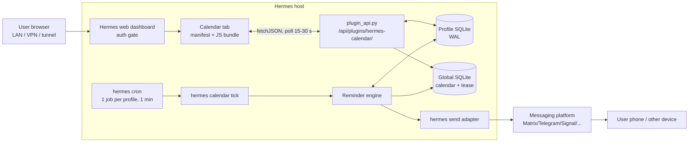
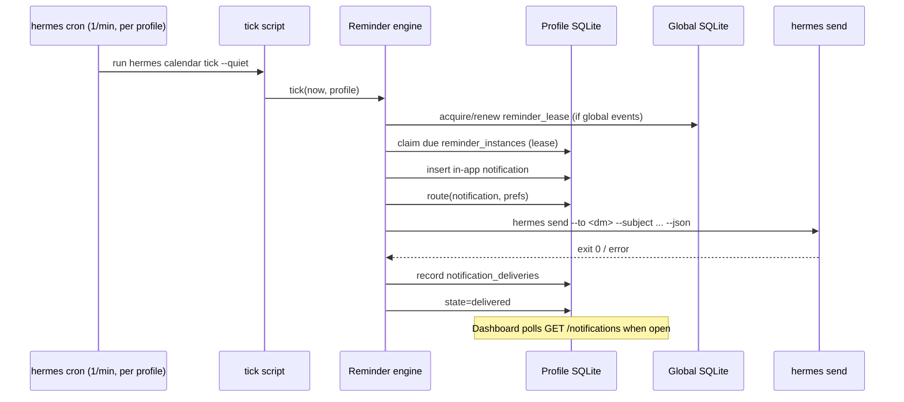

# App notifications and reminders

| | |
|---|---|
| Status | Draft (rev 2) |
| Date | 2026-11-12 |
| Branch | `feature/app-design` (off `test`) |
| Scope | How a calendar reminder reaches the user |
| Decided inputs | UI is a Hermes **web dashboard plugin** on the host; MVP is dashboard + `hermes send` + one cron job |
| Companion docs | `hermes-plugin-ui-and-native.md`, `hermes-plugin-api.md` (branch `feature/research-hermes-api`); `core.md` (branch `feature/core-design`); `sync.md` (branch `feature/sync-design`) |

## TL;DR

**Recommendation: the in-app surface is the Hermes web dashboard plugin, the
out-of-app channel is `hermes send`, and the only scheduler is one per-profile
`hermes cron` job per minute. Web Push, ntfy, Pushover, and desktop
notifications are post-MVP adapters.**

Concretely:

1. **MVP** — a `dashboard/` plugin (`manifest.json` + pre-built JS bundle +
   `plugin_api.py`) renders a notification centre in the existing dashboard,
   behind the existing dashboard auth gate. Every reminder is written there
   first. A single per-minute `hermes cron` job runs the reminder engine and
   delivers due reminders through `hermes send` to one configured DM target.
2. **Post-MVP** — Web Push, ntfy, Pushover, desktop `notify-send`, snooze by
   replying to the bot, digests, and presence suppression, in that order of
   value.
3. **Profiles** — each profile owns its calendar and its own per-minute cron
   job. Global-calendar reminders are delivered by exactly one profile, the
   holder of a lease row in the shared global database. The lease is the
   duplicate-delivery defense; no message bus or extra service is needed.

Web Push is deliberately demoted: the dashboard does not guarantee a stable
HTTPS origin, and service workers, VAPID subscriptions, and iOS installation
all depend on one. The dashboard plugin must not create a second origin or a
second auth system to work around that.

---

## 1. Problem

A calendar is only useful if the user is told when something is about to
happen. The plugin stores events locally and syncs them (see `sync.md`), but
nothing yet decides **when** a reminder fires, **where** it is delivered, or
**what happens when delivery fails**.

The hard parts are not the API calls:

- **The dashboard is usually closed.** A browser tab is not a scheduler, and
  the dashboard backend only runs plugin code when a request arrives.
- **The host is not the user.** The dashboard runs on the Hermes VM; the user
  may be at a desk, on a phone, or asleep.
- **Calendar data is sensitive.** Reminder text leaks titles, locations, and
  attendees to whichever third party carries it.
- **Duplicates destroy trust faster than a missed reminder.** One event can
  have several reminders, several profiles, and several retry paths.
- **Time is hard.** DST, travel, sleep, clock jumps, and catch-up have to be
  designed, not discovered.

### Goals

1. Deliver a reminder within ±60 s of its scheduled time under normal
   conditions, on a channel the user actually looks at.
2. Work with the dashboard closed, the browser closed, and the desktop session
   locked.
3. Require no second account or credential set when Hermes messaging is
   already configured.
4. Keep notification content minimal by default; richer detail is opt-in.
5. Make every attempt observable; a broken channel is visible and testable.
6. Never send the same reminder twice from two tickers or two profiles.

### Non-goals

- A separate local web app, a standalone PWA, or a second auth system. The UI
  is a dashboard plugin.
- A mobile native app.
- Replacing Google/Apple/Outlook native alarms for events that already have
  one.
- Inbound conversational control in v1 (snooze by replying to the bot).
- Rich notification UI (maps, attendee actions) inside the notification.

## 2. Assumptions

- **A1.** The plugin is a native Hermes plugin: `plugin.yaml` + `__init__.py`,
  packaged for others to install, using `plugin_data_dir()` / `plugin_db()`.
- **A2.** The UI is a **Hermes web dashboard plugin** on the Hermes host:
  `dashboard/manifest.json`, a pre-built JS bundle, and
  `dashboard/plugin_api.py` (a FastAPI router). Routes are mounted at
  `/api/plugins/<name>/`; static assets at `/dashboard-plugins/<name>/`;
  everything is behind the dashboard's normal auth gate. There is no separate
  port, bind address, or login.
- **A3.** The plugin has **no reliably running service of its own**.
  `plugin_api.py` runs only while handling a request. The dashboard process is
  not a scheduler for the plugin. A per-profile `hermes cron` job is the
  durable trigger; an optional `ctx.spawn_task` loop is only an accelerator.
- **A4.** Hermes is installed on the host, with at least one messaging
  platform configured. `hermes send --list` returns a usable target for the
  typical user.
- **A5.** The host may be headless. No design may depend on a graphical
  session, a tray, or a browser on the host.
- **A6.** Reminders are single-operator in v1. The dashboard gives plugin
  routes the auth gate, not per-user identity.
- **A7.** Hermes profiles are real: each profile has its own plugin data
  directory and database; a shared global calendar exists at a configured path
  and is writable by every profile (see `core.md` §4 and `sync.md` §5.3).
- **A8.** The sync layer emits event changes and supplies timezone and
  recurrence data; the core owns the canonical event model.
- **A9.** The dashboard is reached over loopback, LAN, VPN, or a reverse proxy
  that the operator already configured. The plugin adds no public URL of its
  own.

## 3. Requirements

| ID | Requirement | Notes |
|---|---|---|
| R1 | Fire N minutes/hours/days before an occurrence, configurable per event and as a default | Offsets survive event edits |
| R2 | Multiple reminders per event, each with its own channel policy | e.g. 1 day → dashboard, 15 min → phone |
| R3 | Recurring events expand correctly, including exceptions and cancellations | Bounded horizon |
| R4 | Correct across DST, timezone changes, and travel | UTC instants; event/user timezone for display |
| R5 | Delivered when the dashboard and browser are closed, and when the host slept through the fire time | Cron trigger + catch-up + stale suppression |
| R6 | Quiet hours; critical reminders may override | Per-user, per-calendar |
| R7 | Snooze (5/15/60/1440 min) and dismiss | In the dashboard for v1 |
| R8 | No duplicate user-visible notification from retries, two tickers, or two profiles | Per-profile lease + global lease |
| R9 | Delivery attempts and failures are visible and testable | Dashboard tab + `hermes calendar doctor` |
| R10 | Minimal content by default; full detail opt-in | Redaction and link policy |
| R11 | No calendar-derived text is executed as a command or template | Injection defense |
| R12 | Works without ntfy/Pushover/Web Push accounts | Those are post-MVP |
| R13 | Respect profiles: private calendar per profile, one shared global calendar | See §6.2 |
| R14 | No separate service, port, TLS certificate, or public URL | Dashboard plugin only |

### Non-functional targets

- **Latency:** p95 ≤ 90 s from `fire_at` to adapter hand-off. The one-minute
  cron tick is the budget; do not promise seconds.
- **Durability:** a fired reminder is never lost before an attempt is
  recorded; attempts survive process restart.
- **Availability:** the dashboard being down must not stop external delivery;
  the cron job is independent of it.
- **Privacy:** no event content in logs by default; secrets never in SQLite,
  the JS bundle, or the repo.
- **Overhead:** the tick is a short Python process; no resident daemon.

## 4. Option space

The options differ less in "can it show a banner" than in **where the user
is**, **what runs when the UI is closed**, and **who sees the data**.

### Option A — Hermes web dashboard plugin (selected in-app surface)

**What it is.** The calendar UI is a plugin tab inside the Hermes web
dashboard. It ships `dashboard/manifest.json`, a pre-built IIFE JS bundle
(`dist/index.js` + optional `dist/style.css`), and an optional
`dashboard/plugin_api.py` FastAPI router. The dashboard mounts the tab at
`/calendar`, serves assets from `/dashboard-plugins/hermes-calendar/`, and
mounts the API at `/api/plugins/hermes-calendar/` behind the dashboard auth
gate. The plugin uses `window.__HERMES_PLUGIN_SDK__` (React, shadcn
primitives, `SDK.fetchJSON`), not a bundled React.

**How reminders appear.** The notification centre is a normal tab: unread
list, next-up card, per-reminder snooze/dismiss, channel settings, and a
delivery log. The page polls `GET /api/plugins/hermes-calendar/notifications`
every 15–30 s; the plugin API has no guaranteed WebSocket/SSE channel. That is
fine: the dashboard is a management surface, not an alerting surface. The
actual alert is `hermes send` (Option D).

**Strengths**

- Zero new distribution: enabling the plugin adds a tab; no port, service,
  TLS certificate, firewall rule, or login.
- Reuses the dashboard's auth gate and remote-access story (loopback tunnel,
  LAN/VPN with basic auth, or reverse proxy). If the operator can already
  reach the dashboard, they can reach the calendar.
- Same-origin API calls with the dashboard session; no CORS design and no
  token handling in JS.
- Best interaction surface: snooze, dismiss, open event, edit reminder,
  inspect delivery failures.
- The JS bundle is static and unauthenticated by design (enabled-gated,
  suffix-allowlisted); keep secrets out of it and it is safe.
- No PWA install funnel and no extra app permission.

**Weaknesses and constraints**

- **It cannot alert when closed.** The dashboard is a web page; when it is not
  open there is no UI to notify. External delivery must be Option D (or a
  post-MVP push adapter).
- **No scheduler inside the page or the API.** `plugin_api.py` runs per
  request, not on a timer. Timers in the browser die with the tab. The cron
  job is mandatory (A3).
- **Reachability is the operator's problem.** The dashboard may be
  loopback-only, a LAN IP on plain HTTP, a tailnet name, or a reverse-proxied
  HTTPS origin. A link that works on the host may not work on the phone.
- **Auth is host-wide, not per-user.** Every logged-in session is the
  operator; the plugin cannot tell users apart.
- **Assets are served without auth** (so `<script>`/`<link>` work). Never put
  secrets, tokens, or private URLs in the bundle.
- **Name coupling.** `dashboard/manifest.json.name` must match the plugin's
  registry key and directory; a mismatch yields a visible tab whose API 404s.
- **JS-only UI.** The asset route's suffix allowlist excludes `.wasm` and
  extensionless binaries; do the work server-side.
- **2-second registration budget** after script load; keep the entry bundle
  small and register immediately.

**Web Push under this shape — and why it is demoted.** Web Push requires a
service worker on a **secure context** (HTTPS, or localhost) and a stable
origin. The dashboard may be served over plain HTTP on a LAN, may be reached
through different origins (loopback, LAN IP, tailnet, reverse proxy), and may
not expose a web app manifest or a service-worker scope at its root. A
subscription is bound to one origin; VAPID keys and subscriptions do not
migrate when the origin changes. On iOS/iPadOS, push works only after the user
adds the site to the Home Screen, which the dashboard is not designed for.
Putting a second origin in front of the plugin to satisfy all this would
violate R14. Therefore Web Push is **post-MVP and conditional** on a stable,
HTTPS, operator-configured `dashboard.public_url`; even then it is an optional
adapter, never the default. The MVP uses `hermes send` for the alert.

**Effort:** medium (UI bundle, API routes, polling, delivery log).
**Cost:** zero. **Privacy:** good (content stays on the host until `hermes
send` hands it to the user's messaging platform).

### Option B — Desktop tray / local notifications

**What it is.** A helper on the machine running the plugin that calls
`notify-send`/libnotify over D-Bus, optionally with a tray icon.

**How it fires.** The cron tick calls `notify-send` when a graphical session
exists on the host.

**Strengths:** native, free, fully local; good when the user is at the host's
desk.

**Weaknesses:** the dashboard runs on a VM (A5); the user's desktop is
elsewhere, so this alerts the wrong machine. It needs a graphical session and
a notification daemon, fails under SSH/containers, and a real cross-platform
tray app is a second artifact and updater. Notification actions and
persistence vary by desktop and are hard to test in CI.

**Verdict:** post-MVP, optional, Linux-host-only. Not a delivery strategy.

**Effort:** low for `notify-send`, high for a tray app. **Cost:** zero.
**Privacy:** excellent.

### Option C — ntfy / Pushover push

Grouped because both give native phone push without a chat bot; they are not
interchangeable.

#### C1. ntfy

**What it is.** HTTP pub/sub notifications. Publish by POSTing to a topic
(`https://ntfy.sh/<topic>` or self-hosted); the ntfy app, web app, or CLI
subscribes. No account required.

**Relevant capabilities:** priorities 1–5 (`min`…`max`/`urgent`), tags/title,
click URL, action buttons (`view`, `http`, `broadcast`, `copy`; up to three),
attachments (ntfy.sh: 15 MB, expire after 3 hours), server message cache (12 h
default), self-hosting, UnifiedPush, access tokens/ACLs on a self-hosted
instance. Body limit is 4,096 bytes by default on ntfy.sh; header values have
non-ASCII encoding caveats.

**Strengths:** simple, cheap, scriptable; works on a phone with no chat
account and no bot identity; self-hosting keeps content local; action buttons
can deep-link into the dashboard.

**Weaknesses:** **the topic is the password** on the public server — use a
long random topic or self-host; ntfy.sh is a third party, so do not assume
end-to-end encryption; no delivery receipts; requires installing the ntfy app;
iOS background delivery depends on APNs and the user's settings.

**Verdict:** post-MVP. The best "native push without a chat bot" option for
users who ask for it.

**Effort:** low. **Cost:** free (self-host costs a host). **Privacy:** fair on
public topics, good self-hosted.

#### C2. Pushover

**What it is.** Paid, polished push with a REST API
(`POST https://api.pushover.net/1/messages.json`, app token + user key),
native clients, and **acknowledgement-required** notifications.

**Relevant capabilities:** priorities −2…2; priority 2 repeats every `retry`
seconds (min 30) until acknowledged or `expire` (max 3 h), returns a
`receipt`, and supports a callback URL; supplementary URL, sounds, TTL,
HTML/monospace, one image attachment (≤5 MB), optional E2EE; 1,024-character
message, 250-character title; 10,000 messages/month free per user; one-time
per-platform client purchase.

**Strengths:** the only option with native repeated-until-acknowledged
delivery; good clients; receipts give real ack state; E2EE reduces exposure.

**Weaknesses:** account + per-platform purchase + registration; the app token
should ideally be the user's own for an open-source distribution; emergency
retries cost quota and annoy if misused; ack callbacks need a publicly
reachable URL (receipt polling is the local-first alternative); 1,024-char
limit; metadata still reaches a third party.

**Verdict:** post-MVP, and only for users who need acknowledgement. It is the
natural escalation channel for `critical`.

**Effort:** low–medium. **Cost:** one-time per-platform purchase; free quota.
**Privacy:** fair (good with E2EE).

### Option D — Hermes gateway messaging via `hermes send` (selected external channel)

**What it is.** Hermes owns credentials and adapters for Telegram, Discord,
Slack, Signal, WhatsApp, Matrix, email, SMS, and others. `hermes send` is a
non-LLM, script-friendly delivery command:

```sh
hermes send --to matrix:@me:example.org --subject "Dentist" \
  "Dentist in 30 min — 3:00 PM"
```

Verified properties:

- Targets: `platform` (home channel), `platform:chat_id`,
  `platform:chat_id:thread_id`, `platform:#channel-name`.
- Reads the body from stdin or `--file -`; `--subject` prepends a header;
  `--json` returns a structured result; `-q` is exit-code only.
- Exit codes: `0` success, `1` delivery/backend error, `2` usage error.
- No LLM, no agent loop, and **no running gateway required for bot-token
  platforms** such as Telegram, Discord, and Slack. Session-based platforms
  may need the gateway runtime; `hermes send --list` and
  `hermes gateway status` are the preflight checks.
- `MEDIA:<path>` attaches an image/document.
- Reuses `~/.hermes/.env` + `~/.hermes/config.yaml`; the user manages no new
  secret.
- Runs from a plain shell, so a cron script can call it with no plugin runtime
  present.

**Why not `ctx.post_message` or `ctx.inject_message`?** `post_message` is
turn-scoped and refuses outside a session. `inject_message` needs
`allow_gateway_injection` and a live gateway; it is the right v2 path for
snooze-by-reply, but it adds a permission and a runtime dependency to the
delivery path. `hermes send` is deliberately dumb, profile-scoped, and
observable via exit code.

**Strengths**

- **Lowest setup friction of any out-of-app channel:** the user already has a
  messaging account and Hermes already has the token.
- Reaches the user wherever they read messages; cross-device by construction.
- No extra app, no PWA install, no ntfy topic.
- Failures are observable via exit code and `--json`; Hermes already handles
  platform formatting and rate limits.
- One adapter covers many platforms, so coverage grows for free.
- Fits the product identity: the calendar lives inside Hermes.

**Weaknesses and constraints**

- **A chat message, not a notification.** It inherits platform noise, mute
  rules, and formatting limits; it can be buried in a busy room.
- **One-way in v1.** Success/failure, not read/acknowledged. Snooze-by-reply
  needs the inbound gateway and message correlation (v2).
- **Platform variance:** message length (Telegram ~4k, Discord 2k, SMS 160),
  Markdown/HTML differences, mention semantics (`@everyone`, `@channel` must
  be neutralized), media support.
- **Rate limits/costs** belong to the underlying platform/account.
- Sending to a shared room exposes calendar content; the default must be a
  **DM to the user**, never a room.
- Requires Hermes messaging to be configured. If not, the channel is
  unavailable and the UI must say so.
- Profile scoping: the send uses the profile's own config; the wrong profile
  sends to the wrong workspace. Run the tick with the intended profile.

**Effort:** low. **Cost:** zero incremental. **Privacy:** depends on the
platform (E2EE on Signal/WhatsApp; server-visible on Telegram/Discord/Slack/
Matrix homeservers).

### Comparison

Scores are 1–5, 5 = best. "Reach when closed" and "setup friction" decide.

| Criterion | A. Dashboard | B. Desktop | C1. ntfy | C2. Pushover | D. `hermes send` |
|---|---:|---:|---:|---:|---:|
| Reach when dashboard/UI closed | 1 | 2 | 5 | 5 | **5** |
| Reach away from the desk | 3 ¹ | 1 | 5 | 5 | **5** |
| Setup friction (5 = none) | **5** | 2 | 3 | 2 | **5** |
| Interaction (snooze/ack) | **5** | 2 | 3 | 4 | 2 |
| Reliability / timeliness | 3 | 4 | 4 | **5** | 4 |
| Privacy | 4 | **5** | 3 | 3 | 3 |
| Cost | **5** | **5** | 5 | 4 | **5** |
| Platform coverage | 4 | 1 | 4 | 4 | **5** |
| Implementation effort (5 = low) | 2 | 3 | 4 | 3 | **5** |
| Extra moving parts | **5** | 3 | 3 | 3 | **5** |

¹ Only when the dashboard is reachable from wherever the user is (LAN/VPN),
and only while it is open. This is interaction reach, not alert reach.

**What the table says:** A is the best place to *manage* reminders and the
worst place to *alert*; D is the best default alert with the least new
surface; B is local convenience; C is the post-MVP native-push escalation.

## 5. Decision

### 5.1 Recommended architecture

**A dashboard UI, one cron-driven engine, and a channel adapter for delivery.**

- **Dashboard plugin is the in-app surface and the source of truth.** Every
  reminder creates a `reminder_instances` row and an in-app notification
  record first. If every external channel fails, the user sees it on the next
  dashboard visit.
- **`hermes send` is the MVP external channel.** Enabled per profile when at
  least one target exists; the target is an explicit **DM** chosen during
  setup. No room default.
- **One per-minute `hermes cron` job per profile is the only scheduler.** It
  invokes `hermes calendar tick --quiet`, which claims due rows and delivers.
  No resident service, no page timer, no assumption that `plugin_api.py` runs
  in the background.
- **The database lease makes concurrency safe.** Within a profile, the lease
  on `reminder_instances` serializes cron, the dashboard's "run now", and any
  optional accelerator. Across profiles, a lease row in the shared global
  database elects one delivery owner for global-calendar reminders.
- **Adapters are post-MVP.** Web Push, ntfy, Pushover, and desktop implement
  the same `Notifier` interface but ship later; the routing schema is ready
  for them now.
- **No separate origin, port, or auth.** Deep links use the dashboard's
  existing origin or are omitted.

Why not Web Push first: it needs a stable HTTPS origin and an installed PWA,
neither of which the dashboard guarantees; it also cannot be the scheduler.
Why not `hermes cron` per reminder: thousands of jobs, lifecycle churn when
events move, and a scheduler that is hard to inspect. One job that calls our
engine keeps reminders in our data model.

### 5.2 MVP scope (exactly this cut)

**In scope**

- `dashboard/` plugin: calendar tab, notification centre, next-up card,
  per-reminder snooze/dismiss, channel settings, delivery log, "send test"
  button.
- `plugin_api.py` routes under `/api/plugins/hermes-calendar/`, behind the
  dashboard auth gate.
- Core reminder definitions (`event_reminders`) + notification instances
  (`reminder_instances`) for the active profile.
- Delivery adapters: `in_app` and `hermes_send` only.
- One `hermes cron` job per profile, every minute, `--no-agent --script`,
  `--deliver local`, running `hermes calendar tick --quiet`.
- Quiet hours, stale suppression, retry/backoff, dedup, per-profile lease,
  global-delivery lease.
- Profiles and the shared global calendar (§6.2).
- `hermes calendar doctor` + dashboard diagnostics.

**Explicitly out of MVP**

- Web Push, VAPID, service workers, PWA installation.
- ntfy and Pushover adapters.
- Desktop `notify-send` / tray.
- Snooze by replying to the bot; read receipts.
- Digests, presence suppression, escalation to a second channel.

**MVP acceptance checks**

1. Enabling the plugin adds a `/calendar` tab inside the existing dashboard,
   behind the existing login; no new port, service, certificate, or password.
2. With the dashboard closed and the browser closed, a reminder due in two
   minutes is delivered by `hermes send` within 90 seconds.
3. Running the cron tick and the dashboard's manual tick at the same moment
   produces exactly one external message and one `reminder_instances` row.
4. An unauthorized request to `/api/plugins/hermes-calendar/notifications`
   returns 401 before the handler runs.
5. The JS bundle contains no token, chat id, calendar content, or endpoint
   secret (grep test).
6. Quiet hours defer `normal` reminders and never defer `critical` ones.
7. A reminder whose event started 12 minutes ago, or whose fire time was more
   than 60 minutes ago, is suppressed and appears in the dashboard, not sent
   late.
8. A failed `hermes send` (bad target) is visible in the delivery log with
   its exit code (1 for delivery, 2 for usage) and falls back to in-app, not
   silence.
9. A global-calendar event is delivered by exactly one profile; killing that
   profile's cron lets another profile take over after lease expiry without a
   duplicate.
10. Uninstalling/disabling the plugin removes or disables its cron job, or
    `doctor` reports the orphan; no reminders keep firing after uninstall.
11. `hermes calendar doctor` exits non-zero when the default external channel
    is missing or broken.
12. Nothing in the MVP requires ntfy, Pushover, a Pushover account, or a
    public URL.

### 5.3 Phasing

| Phase | Ships | Why |
|---|---|---|
| **MVP** | Dashboard centre, `hermes send`, cron engine, quiet hours, snooze, delivery log, profiles + global lease | Reliable default with the least new surface |
| **Phase 2** | Web Push (only with stable HTTPS origin), digests, presence suppression, escalation policy | Native push for deployments that can support it; less noise |
| **Phase 3** | ntfy, Pushover (emergency receipts), desktop `notify-send`, snooze-by-reply | Users who avoid chat bots, need acknowledgement, or work offline |

### 5.4 What we explicitly reject

- **A standalone local web app or PWA** — a second origin, auth system, and
  install funnel that the dashboard already solves.
- **A per-reminder cron job** — lifecycle and observability cost.
- **A browser or `plugin_api.py` timer as the scheduler** — neither runs when
  closed.
- **A tray app as the primary channel** — desk-bound, second artifact.
- **Room delivery by default** — leaks calendar content.
- **Requiring a plugin-owned public URL** — the dashboard's reachability is
  the operator's existing contract (see §6.10).

## 6. Detailed design

### 6.1 Components



| Component | Responsibility | Runs where |
|---|---|---|
| Dashboard tab | Notification centre, settings, delivery log | Browser |
| `plugin_api.py` | Read/write notifications, settings, test send, doctor | Dashboard process, per request |
| `__init__.py` | Tools, CLI command `calendar`, manifest, optional accelerator | Agent/plugin host when loaded |
| Cron job | One per profile, every minute, no agent | Hermes cron scheduler |
| Tick command | Materialize, claim, route, deliver, record | Short-lived Python process |
| Reminder engine | Occurrence expansion, lease, retry, state | Tick process |
| `hermes send` | External delivery | Subprocess |
| Profile DB | Events, definitions, instances, deliveries, prefs | Per profile |
| Global DB | Shared events + `reminder_lease` only | Shared path |

No component holds a long-lived socket. The dashboard API must not block its
event loop: use `async def` and `asyncio.to_thread` for SQLite or subprocess
work.

### 6.2 Profiles and the shared global calendar

Each Hermes profile has its own database (`plugin_data_dir()`/`plugin_db()`)
containing its private calendars, its `event_reminders` definitions, its
`reminder_instances`, its delivery log, and its channel preferences. The
shared global calendar lives in the configured global database
(`calendar.global_db_path`, see `sync.md` §5.3) and contains no personal
notification state.

**Who delivers a global-calendar reminder.** The profile that holds the
global **reminder delivery lease** at fire time. The lease is one row in the
global database:

```sql
-- TODO(core): coordination-only table in the global DB; core currently says
-- the global store has no notification state. Reconcile or reuse sync_lease.
CREATE TABLE reminder_lease (
  scope             TEXT PRIMARY KEY CHECK (scope = 'global'),
  owner_profile_id  TEXT NOT NULL,
  lease_expires_utc INTEGER NOT NULL,
  heartbeat_utc     INTEGER NOT NULL
);

-- Content-free dedup tombstones so a takeover cannot replay a delivery.
-- TODO(core): classify as coordination state, not notification state.
CREATE TABLE reminder_delivery_ledger (
  dedup_key      TEXT PRIMARY KEY,
  delivered_utc  INTEGER NOT NULL,
  profile_id     TEXT NOT NULL
);
```

Acquire/renew exactly like `sync_lease` (`sync.md` §5.9): renew every 60 s,
TTL 180 s, `BEGIN IMMEDIATE`, conditional update, and take over only after
the lease has been expired for a 60 s grace period (a missed heartbeat can
mean the host was suspended). The holder:

1. materializes `reminder_instances` for `store_id = 'global'` events from the
   core definitions;
2. routes and delivers them using **its own** `hermes send` target and
   credentials;
3. renews the lease on every tick.

Non-holder profiles do not materialize or deliver global-event reminders; the
dashboard shows "Global reminders are delivered by profile `<id>`" and a
read-only view. If the holder stops, the next profile's tick acquires the
lease after expiry, materializes from core, and continues. Worst-case
failover latency is ~5 minutes (TTL 180 s + grace 60 s + tick 60 s); the
10-minute stale grace keeps that reminder deliverable rather than lost.

**How duplicates are prevented.** Explicitly:

- **Within a profile**, the lease columns on `reminder_instances`
  (`lease_until_utc`) plus `BEGIN IMMEDIATE` make the cron tick, a dashboard
  "run now", and any optional `ctx.spawn_task` loop mutually exclusive. One
  sender per row.
- **Across profiles**, the global `reminder_lease` is a single mutex in one
  shared database file. Only the holder has eligible rows, so two profiles
  cannot both send the same global event. **For concurrent delivery, the
  database lease is enough** — no message bus, leader-election service, or
  cross-profile RPC is required.
- **After a takeover**, a content-free `reminder_delivery_ledger` row per
  `dedup_key` prevents the returning or replacement holder from replaying a
  reminder that was already sent. The ledger contains no event content; it is
  coordination state, and it is the only piece the lease alone cannot cover.
  When the ledger is unavailable, the design falls back to at-most-once
  (suppress uncertain late rows) rather than risk a duplicate.
- **Profile-local events need no cross-profile coordination**; the event
  exists only in that profile's database, so only that profile's job can see
  it.

**Which profile's gateway delivers** is therefore whichever profile holds the
lease, normally the one that acquired it first and keeps renewing. It is
visible in the dashboard and in `doctor`. Because profiles belong to the same
operator, their `hermes send` target should normally be the same DM; the UI
warns if the holder's target differs from the profile the user is viewing.

**Cron is per profile.** The installer creates the job in each profile that
enables reminders, with that profile's environment. A tick run under the
wrong profile would read the wrong database, so the script must assert the
expected profile (fail closed, log, and exit non-zero). The dashboard plugin
API is not a substitute: under the unified dashboard it serves one selected
profile, and it is not a scheduler anyway.

**Open TODO for core.** `core.md` §5.11 currently says each profile
materializes its own `reminder_instances` for global events. This design
narrows that to "only the lease holder materializes", which is simpler and
removes duplicate-delivery ambiguity. Marked for reconciliation in §6.5.

### 6.3 Reminder lifecycle


Invariants:

- A reminder exists per **(store, event, reminder definition, occurrence)**,
  not per event. Editing an event's time cancels/creates instances; editing
  only its title keeps the instance and re-renders at fire time.
- The in-app row is written **before** any external send. External success is
  an attempt, not the source of truth.
- `Acknowledged`/`Snoozed` are user actions; they are never inferred from a
  platform read receipt (v1 has none).
- More than `stale_grace` (default 10 min) past the occurrence start, a
  never-delivered reminder is `Suppressed`, not delivered late. A reminder
  whose own fire time is more than `max_late_minutes` (default 60) in the past
  is also suppressed, even if the event has not started. Exception: all-day
  events and "missed while away" digest entries.
- Only the delivery owner (the profile holding the global lease for global
  events, or the owning profile for local events) may enter `Firing`.

### 6.4 Scheduling algorithm

1. **Materialize** occurrences for all events in the profile database, plus
   global events if this profile holds the global lease, within a horizon
   (default 90 days, extended daily). Expand RRULE with exceptions; apply
   `TZID` and floating-time rules. Use core's `recurrence_key`.
2. For each occurrence and each applicable `event_reminders` row, compute
   `fire_at_utc = occurrence_start - offset_seconds` as a UTC instant. Use
   the event's timezone for wall-clock offsets ("9:00 local" stays 9:00 local
   across DST). Absolute `VALARM` triggers use `absolute_utc` directly.
3. Recompute on event change, calendar timezone change, user timezone change,
   tzdata update, process start, and once per day.
4. **Claim** due rows in one `BEGIN IMMEDIATE` transaction:
   `state='scheduled' AND fire_at_utc <= now AND (lease_until_utc IS NULL OR lease_until_utc < now)`.
   Set `state='firing'`, `lease_until_utc = now + 120`, `attempt = attempt + 1`.
   This makes every ticker safe. For `store_id='global'`, skip a row whose
   `dedup_key` is already in `reminder_delivery_ledger`, and insert the ledger
   row in the same transaction that records successful delivery.
5. Route and deliver; persist every attempt.
6. Finish as `delivered` (at least one channel), `retrying`, or `failed`.
7. On start, recover rows stuck in `firing` with an expired lease: mark the
   attempt `unknown` and re-route once unless success is provable.

**Cron is the trigger, not a fallback.** In this UI shape there is no
long-running plugin service, so the single per-minute cron safety net is in
fact the primary trigger: it is what makes reminders work. The same job also
performs the global-lease heartbeat and takeover attempt.

**Optional accelerator.** If the plugin is loaded in an agent/gateway process
with a running loop, `ctx.spawn_task` may run a 30 s tick. It must be
best-effort: never required for delivery, disabled by default, and safe
alongside cron because of the lease. It also must be profile-scoped; a bare
thread with no profile context must not run.

**Catch-up.** If the host slept through `fire_at`, the next tick sees
`fire_at < now`. Deliver late, once, only when both conditions hold:
`now - fire_at <= max_late_minutes` (default 60) and
`now <= occurrence_start + stale_grace` (default 10 min). Otherwise suppress
and show it in the dashboard. Prefix the late delivery with "while you were
away" so the user knows it is not a live alert, and avoid a burst after wake.

**Burst control.** If more than three reminders for the same user are due
within two minutes, merge into one "3 events starting soon" message per
channel (configurable). Critical reminders never merge.

### 6.5 Data model (aligned with core; TODOs called out)

**Do not create an `events` table.** Read the canonical model from core
(`events`, `event_instances`, `event_reminders`) and from sync's mapping layer.
The notifications layer owns only the tables below, in the **per-profile**
database, using core's `_utc` epoch-seconds convention.

```sql
-- Notification-owned. Per profile.
-- TODO(core §5.11): column-for-column reconciliation before DDL.
CREATE TABLE reminder_instances (
  id                  TEXT PRIMARY KEY,
  store_id            TEXT NOT NULL,          -- 'profile:<name>' | 'global'
  event_id            TEXT NOT NULL,          -- core events.id (soft ref)
  reminder_id         TEXT NOT NULL,          -- core event_reminders.id
  recurrence_key      TEXT NOT NULL,          -- core occurrence key
  occurrence_start_utc INTEGER NOT NULL,
  offset_seconds      INTEGER NOT NULL,
  fire_at_utc         INTEGER NOT NULL,
  priority            TEXT NOT NULL DEFAULT 'normal'
                      CHECK (priority IN ('digest','normal','high','critical')),
  channel_policy_json TEXT NOT NULL DEFAULT '{}'
                      CHECK (json_valid(channel_policy_json)),
  state               TEXT NOT NULL DEFAULT 'scheduled'
                      CHECK (state IN ('scheduled','firing','retrying',
                        'delivered','snoozed','acknowledged','suppressed',
                        'cancelled','failed','dead_letter')),
  attempt             INTEGER NOT NULL DEFAULT 0 CHECK (attempt >= 0),
  lease_until_utc     INTEGER,
  snooze_until_utc    INTEGER,
  dedup_key           TEXT NOT NULL UNIQUE,
  created_utc         INTEGER NOT NULL,
  updated_utc         INTEGER NOT NULL,
  UNIQUE (store_id, event_id, reminder_id, recurrence_key)
);

CREATE INDEX idx_reminder_instances_due
  ON reminder_instances(state, fire_at_utc);
CREATE INDEX idx_reminder_instances_event
  ON reminder_instances(store_id, event_id);

-- TODO(core §5.11): same table/columns are duplicated there; keep one owner.
CREATE TABLE notification_deliveries (
  id                   INTEGER PRIMARY KEY AUTOINCREMENT,
  reminder_instance_id TEXT NOT NULL
                       REFERENCES reminder_instances(id) ON DELETE CASCADE,
  channel              TEXT NOT NULL,   -- in_app|hermes_send|...
  target               TEXT NOT NULL,   -- opaque, allowlisted
  attempt              INTEGER NOT NULL,
  started_utc          INTEGER NOT NULL,
  finished_utc         INTEGER,
  outcome              TEXT NOT NULL
                       CHECK (outcome IN ('success','transient','permanent','unknown')),
  exit_code            INTEGER,
  provider_id          TEXT,
  error                TEXT,            -- redacted
  latency_ms           INTEGER
);

CREATE TABLE notification_channels (
  id          TEXT PRIMARY KEY,
  kind        TEXT NOT NULL,
  enabled     INTEGER NOT NULL DEFAULT 0 CHECK (enabled IN (0,1)),
  config_json TEXT NOT NULL DEFAULT '{}' CHECK (json_valid(config_json)),
  secret_ref  TEXT,
  created_utc INTEGER NOT NULL
);

CREATE TABLE notification_prefs (
  key        TEXT PRIMARY KEY,
  value_json TEXT NOT NULL CHECK (json_valid(value_json)),
  updated_utc INTEGER NOT NULL
) WITHOUT ROWID;

-- Post-MVP, but the table is reserved so enabling it is not a migration.
CREATE TABLE web_push_subscriptions (
  id             TEXT PRIMARY KEY,
  endpoint       TEXT NOT NULL UNIQUE,
  p256dh         TEXT NOT NULL,
  auth           TEXT NOT NULL,
  user_agent     TEXT,
  created_utc    INTEGER NOT NULL,
  last_success_utc INTEGER,
  failure_count  INTEGER NOT NULL DEFAULT 0
);
```

**TODO — reconcile with core before implementation.** `core.md` §3.7 and
§5.11 are being revised in parallel. This document does **not** claim a
competing schema; it keeps the notification-owned tables and marks the exact
overlap. The rows below list the exact table and column names shared with
core §5.11 (and, for the lease, with `sync_lease` in `sync.md` §5.9).

| Overlapping object | Exact names in this doc | Exact names in core | TODO |
|---|---|---|---|
| Event store | (none — reads core) | `events`: `id`, `uid`, `calendar_id`, `start_utc`, `end_utc`, `start_date`, `end_date`, `start_tz`, `status`, `transparency`, `rrule`, `rev`, `scope` | Delete any local event mirror; resolve by `(store_id, event_id)` |
| Reminder definition | (none — reads core) | `event_reminders`: `id`, `event_id`, `action`, `related`, `trigger_kind`, `offset_seconds`, `absolute_utc`, `repeat_count`, `repeat_interval_seconds` | Confirm which actions the notifier honors (`DISPLAY`, `AUDIO`, `EMAIL`) |
| Reminder instance | `reminder_instances`: `id`, `store_id`, `event_id`, `reminder_id`, `recurrence_key`, `occurrence_start_utc`, `offset_seconds`, `fire_at_utc`, `priority`, `channel_policy_json`, `state`, `attempt`, `lease_until_utc`, `snooze_until_utc`, `dedup_key`, `created_utc`, `updated_utc` | Same table, same names in core §5.11 | Core is revising; re-diff column-for-column before DDL |
| Delivery log | `notification_deliveries`: `id`, `reminder_instance_id`, `channel`, `target`, `attempt`, `started_utc`, `finished_utc`, `outcome`, `exit_code`, `provider_id`, `error`, `latency_ms` | Same table/names in core §5.11 | Confirm `channel` enum once post-MVP adapters are approved |
| Channels | `notification_channels`: `id`, `kind`, `enabled`, `config_json`, `secret_ref`, `created_utc` | Same | Confirm `kind` values are a shared enum |
| Preferences | `notification_prefs`: `key`, `value_json`, `updated_utc` | Same | Confirm global-event prefs belong to the lease holder, not every profile |
| Push subscriptions | `web_push_subscriptions`: `id`, `endpoint`, `p256dh`, `auth`, `user_agent`, `created_utc`, `last_success_utc`, `failure_count` | Same | Post-MVP; keep reserved |
| Global delivery lease | `reminder_lease`: `scope`, `owner_profile_id`, `lease_expires_utc`, `heartbeat_utc` | `sync_lease`: `owner_profile_id`, `lease_expires_at`, `heartbeat_at`; `schema_meta.owner_profile_id` | Decide: separate table, generic lease table, or reuse `sync_lease`; core says the global DB has "no notification state", so this must be classified as coordination state |
| Global delivery ledger | `reminder_delivery_ledger`: `dedup_key`, `delivered_utc`, `profile_id` | (none) | Approve a content-free dedup ledger in the global DB, or accept at-most-once after takeover |
| Global materialization | owner-only | Core §5.11 says every profile materializes its own | Reconcile; owner-only is the duplicate-delivery fix |

Timestamps are epoch seconds UTC (`*_utc`), matching core. `dedup_key` is
`sha256(store_id | event_id | reminder_id | recurrence_key)`; the direct
`UNIQUE` constraint is the real spine.

### 6.6 Adapter contract

Adapters are uniform so routing, retries, and observability are
channel-agnostic. MVP implements only `in_app` and `hermes_send`.

```python
@dataclass(frozen=True)
class Notification:
    id: str                  # dedup_key
    title: str               # sanitized, <= 120 chars
    body: str                # sanitized, plain text
    priority: Literal["digest", "normal", "high", "critical"]
    store_id: str
    event_id: str
    occurrence_utc: int
    deep_link: str | None    # dashboard origin only, else None
    media_path: Path | None

@dataclass(frozen=True)
class DeliveryResult:
    outcome: Literal["success", "transient", "permanent", "unknown"]
    provider_id: str | None
    detail: str | None       # redacted
    latency_ms: int

class Notifier(Protocol):
    name: str
    def available(self) -> Availability: ...   # configured? dependency present?
    def send(self, n: Notification) -> DeliveryResult: ...
```

Result mapping:

| Situation | Outcome | Retry? |
|---|---|---|
| `hermes send` exit 0 | success | no |
| `hermes send` exit 2 (usage) | permanent | no; surface config error |
| `hermes send` exit 1 with backend rejection/4xx | permanent | no; fall back |
| `hermes send` exit 1 with network/timeout/5xx | transient | yes |
| Process killed mid-send | unknown | at most one re-send, then surface |
| Web Push 201 / 404/410 / 429/5xx | success / permanent (prune) / transient | post-MVP |
| ntfy/Pushover 2xx / 4xx / 429/5xx | success / permanent / transient | post-MVP |

**Backoff:** 10 s, 30 s, 2 min, 10 min, 30 min (5 attempts), then fall back to
the next channel, then dead-letter. Jitter ±20%. Critical may use 5 s, 15 s,
60 s, 5 min and a secondary target.

**Ambiguity policy.** A timeout after the request was written is unknown;
prefer one retry over silence, mark `unknown`, and never loop. Dedup by
`Notification.id` in the dashboard so a duplicate attempt is not a duplicate
user-visible row.

### 6.7 Routing policy

Evaluation order:

1. **Eligibility.** Cancelled/declined events suppressed;
   `transparency=transparent` digest-only unless overridden; an event with a
   native alarm is suppressed by default if core preserves `VALARM`
   (see §6.16).
2. **Priority.** Per-reminder overrides event default, which overrides
   calendar default.
3. **Quiet hours** in the user's current timezone:
   - `digest`/`normal`: defer to the end of quiet hours (one digest later).
   - `high`: send unless the user disabled it.
   - `critical`: always send; use the channel's highest urgency.
4. **Availability.** Skip channels that report unavailable (no `hermes send`
   target, no post-MVP subscription) and record why. If no channel is
   available, keep the in-app row and raise a persistent dashboard banner.
5. **Fallback chain.** Try ordered channels until one succeeds; `permanent`
   moves on immediately, `transient` retries in-channel first (bounded),
   `unknown` moves on only after the retry budget.

MVP default policy:

| Priority | Quiet hours | Channels |
|---|---|---|
| `digest` | deferred | in-app (post-MVP digest) |
| `normal` | deferred | in-app → `hermes send` (DM) |
| `high` | omitted unless disabled | `hermes send` (DM) → in-app |
| `critical` | bypassed | `hermes send` (DM) → in-app |

There is **no presence suppression in MVP**. In-app is a record and a badge,
not a second OS alert, so receiving both an in-app row and one chat message is
intended, not a duplicate.

### 6.8 Configuration

Settings live in `notification_prefs` and are edited in the dashboard. YAML
below is illustrative; chat targets are per profile, and secrets are
references.

```yaml
notifications:
  timezone: America/Chicago        # default: system tz
  stale_grace_minutes: 10
  max_late_minutes: 60
  default_offsets: [10, 0]
  quiet_hours:
    start: "21:30"
    end: "07:00"
    allow: [high, critical]
  digest:
    enabled: false                 # post-MVP
  global_calendar:
    delivery_mode: lease           # exactly one profile delivers
    lease_ttl_seconds: 180
    takeover_grace_seconds: 60
  channels:
    - id: in-app
      kind: in_app
      enabled: true
    - id: phone
      kind: hermes_send
      enabled: true
      target: matrix:@me:example.org   # DM resolved at setup
      subject_prefix: "Calendar"
    # post-MVP, rejected by the MVP schema:
    # - id: webpush   kind: web_push   enabled: false
    # - id: ntfy      kind: ntfy       enabled: false
    # - id: pushover  kind: pushover   enabled: false
    # - id: desktop   kind: desktop    enabled: false
  routing:
    - when: { priority: critical }
      channels: [phone, in-app]
    - when: { priority: high }
      channels: [phone, in-app]
    - default: [in-app, phone]
```

Resolution: per-reminder → per-event → per-calendar → profile → built-in
defaults. The dashboard exposes the common knobs; YAML is the escape hatch.

### 6.9 Delivery sequence



The dashboard never triggers cron. A "Run now" button calls
`POST /api/plugins/hermes-calendar/tick`, which runs the same claim path under
the same lease; it is optional and safe.

### 6.10 Message format and deep links

Plain text, one event, minimum detail. Titles are untrusted input.

```
Calendar · in 30 min
Dentist
3:00 PM – 3:45 PM · 123 Main St
Open calendar: https://<dashboard-origin>/calendar?event=<store>:<id>
```

Rules:

- `title` = event summary, control characters stripped, newlines collapsed,
  capped at 120 chars; per-platform escaping applied by the adapter.
- `body` = time range + location only if the user opted into details; default
  is "details in the app".
- No attendee names, descriptions, conferencing URLs, or attachments in
  external messages by default.
- **Deep links use the dashboard's existing origin**, never a plugin-owned
  host or port. Derive it from `dashboard.public_url` when the operator set
  one, otherwise from the incoming request origin (for links generated by a
  UI action); for cron-generated messages there is no request, so use the
  configured public URL.
- If the phone cannot reach that origin, **omit the link** rather than send a
  dead `127.0.0.1`/LAN URL. The message then says "Open the calendar app".
- This answers the former open question: the plugin does **not** need its own
  public base URL, TLS certificate, or DNS name. Reachability is whatever the
  dashboard already exposes (loopback tunnel, LAN/VPN, tailnet, reverse
  proxy). A deployment that wants links on a phone must configure
  `dashboard.public_url`; otherwise links are omitted.
- Discord: neutralize `@everyone`/`@channel`/role mentions. Slack: avoid
  `<!channel>` and unfurls. Telegram: plain text or escaped MarkdownV2; no
  link previews.
- Subject: `Calendar: Dentist in 30 min`.
- Per-platform length caps: truncate the body, never the time or event name;
  log the truncation.

### 6.11 Snooze and acknowledgement

**MVP (dashboard only):**

- Snooze 5/15/60/1440 min, dismiss, open event.
- External messages say "Open the calendar to snooze"; no fake affordance.
- Critical reminders unacknowledged after `escalate_after` (default 5 min)
  are logged for the dashboard; escalation to a second channel is post-MVP.

**Post-MVP (inbound, pending `hermes-plugin-api.md` research):**

- Send with `--json`, store the platform message id if returned.
- A gateway hook matches a DM reply to a recent reminder; commands:
  `snooze 15`, `done`, `mute 1h`.
- Requires message-id correlation or an explicit per-reminder token, a
  sender-ID allowlist, DM-only routing, and strict parsing (no free-form LLM
  in the delivery path).
- `ctx.inject_message` with `allow_gateway_injection` is the supported way to
  wake a chat from background work; it is optional and fail-closed, so it is
  not the MVP path.

### 6.12 Reliability details

- **One job per profile.** Created on enable, removed on disable/uninstall
  (with confirmation). Jobs outlive plugins, so orphan cleanup is mandatory;
  `doctor` reports a job whose plugin is gone.
- **Job definition:**
  ```sh
  # installed under ~/.hermes/scripts/, in each profile that enables reminders
  hermes cron create --name "calendar reminders" --no-agent \
    --script hermes-calendar-tick.sh --deliver local --catch-up on "1m"
  ```
  The script runs `hermes calendar tick --quiet`, prints nothing (non-empty
  stdout would be captured by cron and can duplicate the adapter's message),
  asserts the expected profile, and exits 0. `--deliver local` keeps cron's
  own output out of chat.
- **Single-flight.** SQLite lease + `BEGIN IMMEDIATE`; cron, dashboard "run
  now", and the optional accelerator cannot double-send. The concurrency test
  is mandatory.
- **Profile assertion.** A tick under the wrong profile is a hard error, not a
  silent send from the wrong calendar.
- **Global lease.** Renew every 60 s, TTL 180 s, 60 s takeover grace; only the
  holder materializes/delivers global reminders. See §6.2.
- **`hermes pause`.** Pausing Hermes stops cron dispatch. Reminders then do
  not fire; the dashboard shows "background delivery paused". Do not try to
  defeat the emergency stop.
- **Clock.** Store `last_tick_utc`; a backward jump >60 s waits for the next
  tick rather than re-firing. Forward jumps use the normal stale logic.
- **Timezones.** IANA tz database, not fixed offsets; recompute future
  `fire_at_utc` on tzdata update. All-day events fire at a user-configured
  local time (default 07:00), never at midnight.
- **DST.** Absolute instants are UTC math. Wall-clock digests skip a
  nonexistent 02:30 and fire once for an ambiguous 01:30 (first fold).
- **Recurrence.** Bounded expansion; respect `EXDATE`, `RECURRENCE-ID`
  overrides, `STATUS:CANCELLED`.
- **Native alarms.** If core preserves `VALARM` and sync keeps it, default to
  not duplicating it; expose a per-calendar toggle.
- **Dashboard down.** External delivery is unaffected; the in-app rows
  accumulate and appear on the next visit.

### 6.13 Security and privacy

| Threat | Mitigation |
|---|---|
| Calendar text injected into `hermes send`/`notify-send` | Never build a shell string; use `argv` with single-token `--to=`/`--subject=` options; neutralize every Hermes message directive (`MEDIA:`, `[[as_document]]`, `[[audio_as_voice]]`) including case/whitespace/zero-width/full-width variants and break bare absolute/`~/`/drive-letter local paths before rendering; sanitize control chars; cap length; no template evaluation |
| Mention injection (`@everyone`, `<!channel>`) | Escape/disable mentions per adapter; snapshot tests |
| Wrong room/target | Target allowlist from setup; explicit DM; refuse room targets unless opted in per channel |
| Secret leakage | Secrets in Hermes `.env`/OS keyring, referenced by `secret_ref`; never in SQLite, logs, or the JS bundle |
| Bundle inspection | Assets are unauthenticated by design; keep them static, no tokens, no chat ids, no calendar content |
| Plugin API abuse | Routes sit behind the dashboard auth gate; unauthenticated requests 401 before the handler; do not add an unauthenticated route |
| CSRF / same-origin | Use the dashboard session via `SDK.fetchJSON`; do not accept cross-origin writes; validate `Origin` on mutations |
| Host-wide auth vs per-user | Single-operator assumption (A6); no per-user calendar sharing in v1 |
| Calendar content to a third party | Minimal payload; per-channel "include location/details" opt-in; self-hosted ntfy and Pushover E2EE documented post-MVP |
| ntfy topic guessing | 32+ char random topic or self-host; treat topic as a password; never log it |
| Web Push endpoint leak (post-MVP) | Capability URL; store encrypted/hashed; prune 404/410 |
| Dashboard reachable on LAN | The operator's dashboard auth gate is the boundary; the plugin adds no bind and no bypass |
| Logs as a privacy leak | Redact bodies by default; log ids, channel, outcome, latency, exit code only |
| Unauthorized inbound commands (post-MVP) | Sender-ID allowlist, DM-only, reply-token correlation, strict grammar |

The plugin must not trust `X-Forwarded-*` headers or assume TLS; that is the
dashboard/reverse-proxy contract, not the plugin's.

### 6.14 Observability

Metrics (local):

- `reminders_due_total`, `reminders_delivered_total{channel}`,
  `reminders_failed_total{channel,reason}`, `delivery_latency_seconds`
  (histogram), `retry_attempts_total`, `channel_unavailable{channel}`,
  `scheduler_lease_conflicts`, `global_lease_owner{profile}`.

Every attempt is a `notification_deliveries` row with a redacted error. The
dashboard tab shows:

- Per-channel status (configured / available / last success / last error).
- "Send test notification" per channel, through the real adapter, reporting
  the exit code.
- A delivery log filterable by event and channel.
- Warnings for: no external channel, `hermes send --list` empty, gateway down
  for a platform that needs it, missing keyring entry, cron job
  missing/paused, orphaned job after uninstall, global lease held by another
  profile.

`hermes calendar doctor` performs the same checks headlessly, exits non-zero
on a broken essential channel, and is the diagnostic for bug reports.

### 6.15 Testing

| Layer | What to test |
|---|---|
| Unit | Offset math, UTC conversion, DST both directions, all-day default, RRULE/`EXDATE`/overrides, quiet hours, dedup keys, sanitization/truncation, backoff, deep-link omission |
| Engine | Claim/lease with two concurrent ticks; crash recovery; stale suppression; burst merging; clock jumps; wrong-profile refusal |
| Profiles | Global lease acquire/renew/takeover; owner-only materialization; no duplicate across profiles; non-holder dashboard read-only |
| API | Auth gate 401; `SDK.fetchJSON` same-origin; no secret in bundle; async handlers don't block; 60 s timeout behavior; manifest name matches registry key |
| Adapters | Fake `hermes` executable (exit 0/1/2, timeout, malformed JSON); fake HTTP for post-MVP ntfy/Pushover; `notify-send` absent |
| Integration | Real `hermes send --to` against a local test target (opt-in, CI-skipped); dashboard tab loads in a headless browser and registers within 2 s |
| E2E | Event 2 min out → fires once → snooze 15 → fires again; dashboard closed → cron delivers; kill holder → takeover without duplicate |
| Content | Snapshot per platform: no `@everyone`, no localhost link, truncation keeps time + title, unicode/emoji, RTL |

**Concurrency and profile tests are mandatory.** Duplicate reminders are the
most likely user-visible bug, and the cron + manual tick + lease design makes
them a real risk unless proven.

### 6.16 Other acceptance criteria (beyond the MVP cut)

1. With the machine suspended across `fire_at` and resumed within the
   catch-up window (event not started, fire time < 60 min old), the reminder
   is delivered once with a "while you were away" prefix; past the window it
   is suppressed and appears in the dashboard.
2. A fired reminder survives a process kill between claim and send without
   being lost and without more than one user-visible copy.
3. No event title, description, location, or attendee appears in logs at
   default settings.
4. `doctor` reports every channel's state and exits non-zero when the default
   external channel is broken.
5. (Post-MVP) Web Push works only on a stable HTTPS dashboard origin and says
   so when the origin is HTTP or changes; ntfy/Pushover/desktop are opt-in and
   independently disableable.

## 7. Risks and open questions

### Risks

| Risk | Likelihood | Impact | Mitigation |
|---|---|---|---|
| Duplicate sends from cron + manual tick + multiple profiles | Medium | High (trust) | Per-profile lease + global `reminder_lease` + concurrency tests |
| User never configures `hermes send` | Medium | High (missed reminders) | Onboarding detects `hermes send --list`, offers a one-click DM, warns persistently; dashboard-only fallback is explicit |
| Chat noise → user mutes the bot | Medium | High | DM-only default, quiet hours, per-calendar routing; ntfy/Pushover later |
| Dashboard unreachable from the phone | High | Medium | Deep links omitted unless `dashboard.public_url` is set; alert still arrives via chat |
| Dashboard auth misconfiguration | Medium | High | Reuse the gate; fail closed; `doctor` verifies 401 and target; no bypass route |
| Cron job orphaned after uninstall | Medium | Medium | Record job id; disable/remove on uninstall; `doctor` reports orphans |
| Wrong-profile tick | Low | High | Explicit profile assertion in the script and engine; fail closed |
| Global lease holder dies | Medium | Medium | 180 s TTL + 60 s grace; stale grace 10 min; dashboard shows owner |
| Ambiguous retry duplicates | Medium | High | `unknown` policy, one retry, dedup by `Notification.id` |
| tzdata / RRULE edge cases | Medium | Medium | UTC storage, test tables, bounded expansion |
| Host sleeps through reminders | High | Medium | Catch-up + stale suppression + dashboard record |
| `hermes` CLI changes (`send` flags/exit codes) | Low | High | Adapter isolation, version check, contract tests |

### Open questions

1. **Inbound control.** Does `hermes send --json` return a platform message id
   suitable for reply correlation? (Owner: `research-hermes-api`.) If not,
   snooze-by-reply needs an explicit token or stays deferred.
2. **Dashboard profile scope.** Under the unified dashboard server, which
   profile does `plugin_api.py` read? Does the tab need a profile switcher, or
   does each profile get an isolated dashboard? The cron path is per profile
   regardless; this affects only the UI.
3. **Global settings ownership.** Global reminders use the lease holder's
   `hermes send` target and preferences. Is that acceptable, or should global
   reminder settings live in the global DB (which core currently says has no
   notification state)?
4. **Public base URL — resolved.** The plugin does **not** require one. It
   uses the dashboard's existing origin when configured
   (`dashboard.public_url`) and omits deep links otherwise. No plugin-owned
   origin, certificate, or DNS name.
5. **Native alarms.** Does core preserve `VALARM`? If yes, default
   suppression avoids double-notifying, but users must be able to opt back in.
6. **Pushover app token (post-MVP).** Distribute the plugin's own token, or
   require each user to register one? The API guidance leans toward per-user
   registration for open-source clients.
7. **Desktop helper (post-MVP).** Is `notify-send` enough, or is a tray app
   expected? The latter is a separate artifact and its own design doc.
8. **Multi-user.** Shared calendars with per-attendee routing are out of
   scope; the schema should not preclude a future `user_id`.

## 8. Appendix

### A. `hermes send` invocation patterns

```sh
# DM reminder, structured result
hermes send --to matrix:@me:example.org \
  --subject "Calendar: Dentist in 30 min" --json \
  "Dentist · 3:00–3:45 PM"

# Pipe the body (avoids shell quoting entirely)
printf '%s\n' "$BODY" | hermes send --to telegram --subject "$SUBJECT" -q

# Preflight
hermes send --list
hermes send --list matrix
```

Implementation notes:

- `subprocess.run([...], input=body, capture_output=True, timeout=30)`;
  never `shell=True`.
- Parse `--json` defensively; stdout is untrusted.
- Exit `2` = configuration error surfaced in the dashboard; `1` = delivery
  failure; `0` = success.
- Per-adapter timeouts; a hung platform must not stall the tick.
- Truncate to the platform limit before the call, not after a rejection.
- Run with the intended profile; `hermes send` uses that profile's config.

### B. Priority mapping

| Internal | `hermes send` | ntfy (post-MVP) | Pushover (post-MVP) | Desktop (post-MVP) | Web Push (post-MVP) |
|---|---|---|---|---|---|
| `digest` | batched | 2 (`low`) | −1 | low | `very-low` |
| `normal` | normal | 3 (`default`) | 0 | normal | `normal` |
| `high` | normal, no quiet hours | 4 (`high`) | 1 | normal | `high` |
| `critical` | normal + dashboard escalation marker | 5 (`max`) | 2 (retry/expire) | critical | `high` + require interaction |

### C. Channel onboarding checklist (dashboard)

1. Verify the plugin is enabled and `dashboard/manifest.json.name` matches the
   registry key; open `/calendar`.
2. Detect `hermes send --list`; if targets exist, offer them as the default
   external channel, defaulting to a DM. Send a test message.
3. If no targets: explain `hermes gateway setup`, keep in-app reminders
   working, and show a persistent warning.
4. Create the per-profile cron job (or explain why it cannot be created),
   verify it runs, and show the next run time.
5. Show a "reminders will reach you here" summary and warn if only in-app is
   enabled.
6. Post-MVP: offer ntfy/Pushover under "Advanced"; offer Web Push only when
   the dashboard has a stable HTTPS origin, and explain the iOS Home Screen
   requirement rather than failing silently.

### D. Alternatives considered and deferred

- **Web Push as the primary channel** — needs a stable HTTPS origin, a
  service worker, VAPID, an installed PWA, and iOS Home Screen installation;
  the dashboard guarantees none of these. Deferred and conditional.
- **Email via `hermes send`/SMTP** — works everywhere but attention/latency
  are poor for reminders; already available through `hermes send` if the user
  configures email, so no separate adapter.
- **Home Assistant / generic webhook** — home automation, not a person;
  later adapter.
- **ntfy Matrix gateway** — adds a room and a bridge for no benefit over a
  direct ntfy target.
- **Native mobile app** — best long-term push story, out of scope.

### E. Implementation checklist

- [ ] `dashboard/manifest.json` (name matches registry key), pre-built bundle,
      SDK registration within 2 s
- [ ] Notification centre, next-up card, snooze/dismiss, settings, delivery log
- [ ] `plugin_api.py`: async routes, auth-gated, same-origin, no secrets
- [ ] Core-aligned schema + migrations; reconcile §6.5 TODO with `core.md`
- [ ] Occurrence expansion + tz/DST test table
- [ ] Engine claim/lease/retry/fallback; wrong-profile refusal
- [ ] `hermes_send` adapter + fake-CLI contract tests
- [ ] Per-profile cron installer + `--no-agent` script + uninstall cleanup
- [ ] Per-profile lease + global `reminder_lease` acquire/renew/takeover
- [ ] Quiet hours, burst merging, stale suppression
- [ ] Deep links from `dashboard.public_url` only; omission path
- [ ] `hermes calendar doctor`, test-send, metrics, redacted logs
- [ ] Docs: dashboard setup, `hermes send` target, cron job, profiles, privacy
- [ ] Post-MVP: Web Push (stable HTTPS only), ntfy, Pushover, desktop,
      snooze-by-reply
